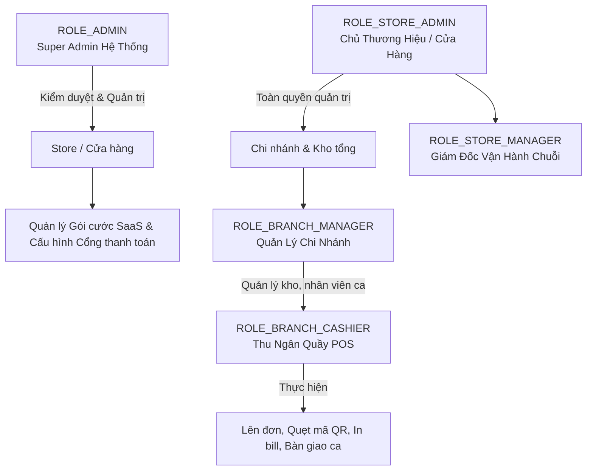

# Fashion POS AI - Smart Retail & Multi-Branch POS System

Hệ thống Quản lý Bán lẻ & Điểm bán hàng (POS) đa chi nhánh thông minh dành cho ngành thời trang, tích hợp trợ lý **AI Copilot (Google Gemini)** hỗ trợ lên đơn bằng giọng nói, gợi ý bán chéo (Cross-sell), cảnh báo tồn kho và phân tích doanh thu tự động.

---

## 📋 Mục Lục (Table of Contents)
- [Giới Thiệu](#giới-thiệu)
- [Tính Năng Nổi Bật](#tính-năng-nổi-bật)
- [Kiến Trúc & Phân Quyền Hệ Thống](#kiến-trúc--phân-quyền-hệ-thống)
- [Công Nghệ Sử Dụng](#công-nghệ-sử-dụng)
- [Cấu Trúc Thư Mục](#cấu-trúc-thư-mục)
- [Hướng Dẫn Cài Đặt & Chạy (Getting Started)](#hướng-dẫn-cài-đặt--chạy-getting-started)
- [Cấu Hình Môi Trường (.env / properties)](#cấu-hình-môi-trường-env--properties)
- [API Documentation (Nếu có)](#api-documentation)
- [Đóng Góp (Contributing)](#đóng-góp-contributing)
- [License](#license)

---

## 🚀 Giới Thiệu

Trong kỷ nguyên bán lẻ đa kênh, các chuỗi cửa hàng thời trang đối mặt với nhiều thách thức: quản lý tồn kho phân tán giữa nhiều chi nhánh, tốc độ thanh toán tại quầy vào giờ cao điểm, tỷ lệ bán chéo (cross-sell) thấp, và quy trình bàn giao ca - kiểm két tiền mặt dễ xảy ra thất thoát.

**Fashion POS AI** là giải pháp toàn diện theo mô hình **SaaS Multi-Tenant**, giải quyết triệt để các bài toán trên:
- **Tự động hóa vận hành:** Giúp thu ngân lên đơn siêu tốc bằng giọng nói / câu lệnh tự nhiên, in hóa đơn tức thì, tính toán hoàn trả và kiểm két chính xác từng đồng.
- **Trí tuệ nhân tạo (Gemini AI):** Đóng vai trò trợ lý kinh doanh ảo cho chủ cửa hàng và quản lý chi nhánh – tự động phân tích doanh thu, cảnh báo rủi ro hoàn tiền, gợi ý nhập kho những món sắp đứt hàng và tự động tạo mã coupon xả hàng tồn đọng lâu ngày.
- **Mô hình Subscription linh hoạt:** Hỗ trợ tính năng Feature-Gate và phân bổ hạn mức chi nhánh, nhân sự, sản phẩm theo từng gói cước (Starter, Pro, Enterprise).

---

## ✨ Tính Năng Nổi Bật

### 1. Trợ Lý Bán Hàng & Kinh Doanh Thông Minh (Gemini AI Copilot)
- [x] **Lên đơn nhanh bằng giọng nói / văn bản tự nhiên (AI Quick Order):** Thu ngân chỉ cần đọc hoặc gõ câu lệnh (VD: *"Lấy 2 áo polo trắng, 1 quần jean cho khách 0912345678 áp mã SALE10 thanh toán thẻ"*), hệ thống tự động bóc tách SKU, số lượng, khách hàng, mã giảm giá và phương thức thanh toán vào giỏ hàng.
- [x] **Gợi ý bán chéo thông minh (Smart Cross-sell & Upsell):** Thuật toán AI phân tích lịch sử mua sắm và giỏ hàng hiện tại để gợi ý 3 sản phẩm mua kèm tiềm năng nhất ngay tại quầy thu ngân.
- [x] **Cảnh báo tồn kho & Gợi ý nhập hàng (Smart Restock):** Dự báo nguy cơ thiếu hàng dựa trên tốc độ bán thực tế 30 ngày gần nhất và cho phép tạo phiếu nhập kho 1-click (`+Kho`).
- [x] **Tự động đề xuất mã giảm giá xả kho (Auto-Coupon Generator):** Nhận diện các mặt hàng có lượng tồn kho cao nhưng sức mua chậm để tự động sinh mã khuyến mãi kích cầu.
- [x] **Tóm tắt bàn giao ca AI (Shift Handover Copilot):** Tự động đối chiếu số dư tiền mặt thực thu sau khi trừ đơn hoàn trả (Refunds), lập báo cáo bàn giao ca chi tiết kèm nhận xét chuyên nghiệp.

### 2. Trạm Bán Hàng Thu Ngân (Cashier POS Terminal)
- [x] **Bố cục 3 cột trực quan:** Danh mục & sản phẩm hiển thị dạng lưới kèm hình ảnh; Giỏ hàng thời gian thực; Thanh toán & thông tin khách hàng.
- [x] **Phím tắt chuyên nghiệp:** `F1` (Tìm sản phẩm), `F2` (Áp mã giảm giá), `F3` (Tìm khách hàng), `F4` (Mở đơn tạm giữ - Held Orders), `Ctrl + Enter` (Thanh toán nhanh).
- [x] **Quản lý đơn tạm giữ (Hold / Resume Orders):** Lưu tạm đơn hàng khi khách chờ chọn thêm đồ và phục vụ khách tiếp theo mà không mất giỏ hàng.
- [x] **In hóa đơn & Xuất PDF:** Xuất hóa đơn bán lẻ chuyên nghiệp trực tiếp hoặc tải file PDF chuẩn hóa với `@react-pdf/renderer`.
- [x] **Xử lý hoàn trả hàng (Refund System):** Tra cứu theo mã đơn hàng, chọn từng sản phẩm hoàn trả, ghi nhận lý do và cập nhật hoàn kho tức thì.
- [x] **Quản lý ca làm việc (Shift Management):** Mở ca, theo dõi doanh thu gộp/ròng, tiền mặt trong két, phân tích các hình thức thanh toán và chốt ca an toàn.

### 3. Quản Trị Chuỗi Cửa Hàng & Chi Nhánh (Store & Branch Management)
- [x] **Quản lý danh mục & sản phẩm thời trang:** Quản lý SKU, giá vốn, giá bán, kích cỡ, màu sắc, hình ảnh (upload Cloudinary / Local Storage).
- [x] **Kiểm soát kho hàng đa chi nhánh (Inventory Tracking):** Thiết lập ngưỡng tồn kho tối thiểu (Min stock level), điều chuyển hàng hóa giữa các chi nhánh (`/api/inventories/transfer`).
- [x] **Quản lý nhân viên & Phân quyền bảo mật:** Thêm mới nhân sự, cấp phát tài khoản, quản lý quyền đăng nhập (`login_access`), khóa quyền tức thì khi nghỉ việc.
- [x] **Quản lý khách hàng thân thiết:** Hồ sơ khách hàng, số điện thoại, tích điểm thưởng và theo dõi toàn bộ lịch sử mua hàng.
- [x] **Chương trình khuyến mãi & Coupon:** Tạo mã giảm giá theo tỷ lệ (%) hoặc số tiền cố định, thiết lập giá trị đơn hàng tối thiểu và hạn sử dụng.
- [x] **Báo cáo & Phân tích trực quan:** Biểu đồ doanh thu Recharts theo ngày, tháng, nhóm sản phẩm, chi nhánh và top thu ngân xuất sắc.

### 4. Đa Cổng Thanh Toán (Omni-Payment Gateway)
- [x] **Tiền mặt (Cash):** Tính toán tiền khách đưa và tiền thối tự động.
- [x] **Chuyển khoản QR (VietQR / MoMo):** Sinh mã QR thanh toán động kèm trang Checkout Mobile giả lập, tích hợp Webhook IPN cập nhật trạng thái đơn hàng thời gian thực.
- [x] **Cổng thanh toán quốc tế:** Tích hợp SDK Stripe & Razorpay cho giao dịch thẻ tín dụng quốc tế.

### 5. Quản Trị Hệ Thống SaaS (Super Admin Portal)
- [x] **Kiểm duyệt cửa hàng:** Phê duyệt đơn đăng ký mở cửa hàng mới (Pending $\rightarrow$ Active), đình chỉ hoạt động các chuỗi vi phạm chính sách (Blocked).
- [x] **Quản lý gói dịch vụ (Subscription Plans):** Thiết lập tính năng động cho từng gói (AI Copilot, Inventory, Multi-location, Advanced Reports) cùng hạn mức tài nguyên (Max Branches, Max Users, Max Products).
- [x] **Cấu hình phí hoa hồng (Commissions):** Thiết lập tỷ lệ hoa hồng theo từng cửa hàng, theo dõi doanh thu toàn sàn.
- [x] **Báo cáo & Xuất dữ liệu:** Xuất danh sách cửa hàng, báo cáo tài chính sang định dạng CSV/Excel.

---

## 👥 Kiến Trúc & Phân Quyền Hệ Thống

Hệ thống được thiết kế theo cơ chế **Role-Based Access Control (RBAC)** chặt chẽ với 5 cấp quyền người dùng:



| Vai Trò (Role) | Phạm Vi Hoạt Động | Chức Năng Chính |
| :--- | :--- | :--- |
| **ROLE_ADMIN** (Super Admin) | Toàn bộ hệ thống | Quản lý chuỗi cửa hàng, duyệt đăng ký, thiết lập gói cước SaaS, quản lý hoa hồng, cấu hình cổng thanh toán sàn. |
| **ROLE_STORE_ADMIN** | Chuỗi cửa hàng sở hữu | Quản trị thương hiệu, tạo chi nhánh, quản lý bảng giá/sản phẩm/coupon, nâng cấp gói cước, xem AI Store Insights. |
| **ROLE_STORE_MANAGER** | Chuỗi cửa hàng | Hỗ trợ chủ thương hiệu giám sát tình hình kinh doanh, điều chuyển kho, xem báo cáo toàn chuỗi. |
| **ROLE_BRANCH_MANAGER**| 01 Chi nhánh cụ thể | Giám sát ca làm việc, quản lý kho chi nhánh, xuất nhập tồn, phân tích hiệu suất thu ngân, xử lý đổi trả hàng. |
| **ROLE_BRANCH_CASHIER**| 01 Quầy POS chi nhánh | Mở/đóng ca, lên đơn AI, quét mã vạch, áp mã giảm giá, thu tiền (Cash/QR/Card), in hóa đơn, bàn giao ca. |

---

## 🛠 Công Nghệ Sử Dụng

### Backend
- **Core Platform:** Java 17, Spring Boot 3.5.8
- **Security:** Spring Security 6, JWT (JSON Web Token - `io.jsonwebtoken 0.12.6`), BCrypt Password Encoder
- **Database & ORM:** MySQL 8.0, Spring Data JPA, Hibernate ORM
- **AI Integration:** Google Gemini API (`gemini-2.5-flash`), Spring RestTemplate / Jackson JSON
- **Payment SDKs:** Stripe Java SDK (`v28.3.1`), Razorpay Java SDK (`v1.4.8`), Tích hợp MoMo/VietQR Webhook
- **Utilities:** Lombok, Spring Boot Starter Mail, Hibernate Validator, Dynamic Schema Migration Fixer

### Frontend
- **Framework & Build Tool:** React 19, Vite 7
- **State Management:** Redux Toolkit (`@reduxjs/toolkit`), React Redux
- **Routing:** React Router v7
- **Styling & UI Kit:** Tailwind CSS v4, Radix UI Primitives, Lucide React Icons
- **Data Visualization:** Recharts
- **PDF & Export:** `@react-pdf/renderer`
- **Form & Validation:** Formik, React Hook Form, Yup, Zod
- **HTTP Client:** Axios (Custom Interceptors với cơ chế tự động đính kèm Bearer token và xử lý FormData)

### DevOps & Cơ Sở Hạ Tầng
- **Containerization:** Docker, Docker Compose
- **Database Service:** MySQL Container (Port 3306)
- **Local Storage:** Thư mục lưu trữ media tự động `/uploads`

---

## 📂 Cấu Trúc Thư Mục

```text
fashion_pos_ai/
├── docker-compose.yml              # File chạy Docker MySQL 8.0
├── docs/                           # Tài liệu và hình ảnh minh họa
│   └── images/                     # Ảnh chụp màn hình ứng dụng (Landing, Dashboard, Analytics)
├── uploads/                        # Thư mục lưu trữ hình ảnh tải lên cục bộ
│
├── pos-backend/                    # SOURCE CODE BACKEND (Spring Boot)
│   ├── Dockerfile                  # Multi-stage Dockerfile build Java 17 JAR
│   ├── pom.xml                     # Cấu hình Maven dependencies
│   └── src/
│       ├── main/
│       │   ├── java/com/zosh/
│       │   │   ├── ZoshPosSystemApplication.java # Entry point ứng dụng
│       │   │   ├── configuration/  # Bảo mật, JWT, CORS, DatabaseSchemaFixer
│       │   │   ├── controller/     # 21 REST API Controllers (Auth, AI, Order, POS,...)
│       │   │   ├── domain/         # Enums hệ thống (UserRole, OrderStatus, PlanFeature,...)
│       │   │   ├── exceptions/     # Global Exception Handler & Custom Exceptions
│       │   │   ├── mapper/         # Model-to-DTO Mappers
│       │   │   ├── modal/          # 20 JPA Entities (User, Store, Product, Order,...)
│       │   │   ├── payload/        # DTOs, Request/Response payloads, AI DTOs
│       │   │   ├── repository/     # Spring Data JPA Repositories
│       │   │   └── service/        # Business Logic Interfaces & Implementations
│       │   │       ├── impl/       # Chi tiết cài đặt dịch vụ
│       │   │       ├── AiCopilotService.java      # Xử lý tương tác Gemini AI & NLP
│       │   │       └── PlanLimitChecker.java      # Quản lý hạn mức & cờ tính năng gói cước
│       │   └── resources/
│       │       └── application.properties         # Cấu hình DB, JWT, Gemini API, Mail
│       └── test/                   # Unit test & Integration test
│
└── pos-frontend/                   # SOURCE CODE FRONTEND (React + Vite)
    ├── package.json                # Quản lý thư viện và scripts frontend
    ├── vite.config.js              # Cấu hình Vite bundler & path aliases (@)
    ├── public/                     # Tài nguyên tĩnh
    └── src/
        ├── App.jsx                 # Bộ định tuyến trung tâm và bộ lọc trạng thái Store
        ├── main.jsx                # Entry point gắn Redux Provider & Router
        ├── components/             # Reusable UI Components
        │   ├── ai/                 # Trợ lý AI (AiBusinessCopilotCard, SmartPosAssistantBar,...)
        │   ├── ui/                 # Shadcn/Radix UI Primitives (Button, Dialog, Card,...)
        │   └── FeatureGate.jsx     # Bộ chặn giao diện theo quyền hạn gói cước
        ├── context/                # SidebarContext & ThemeProvider
        ├── hooks/                  # Custom Hooks (usePlanEntitlements, useSidebar,...)
        ├── pages/                  # Các trang theo từng phân quyền người dùng
        │   ├── common/             # Landing page, Đăng nhập, Quên mật khẩu, 404
        │   ├── onboarding/         # Luồng đăng ký mở chuỗi cửa hàng mới
        │   ├── cashier/            # Màn hình bán hàng POS 3 cột của thu ngân
        │   ├── Branch Manager/     # Bảng điều khiển quản lý chi nhánh & kho
        │   ├── store/              # Bảng điều khiển Store Admin (Sản phẩm, Khuyến mãi,...)
        │   └── SuperAdminDashboard/# Bảng điều khiển quản trị viên hệ thống
        ├── Redux Toolkit/          # Redux Store & 15+ Slices/Thunks
        ├── routes/                 # Khai báo Route độc lập cho từng Role
        └── utils/                  # Cấu hình Axios (`api.js`), Format tiền tệ/ngày tháng
```

---

## 🚀 Hướng Dẫn Cài Đặt & Chạy (Getting Started)

### Yêu Cầu Tiên Quyết
- **Java Development Kit (JDK):** Phiên bản 17 trở lên
- **Node.js:** Phiên bản 18 trở lên (Khuyến nghị dùng `npm` hoặc `pnpm`)
- **Docker & Docker Compose:** Dùng để khởi động nhanh cơ sở dữ liệu MySQL
- **Maven:** 3.8+ (hoặc dùng Maven tích hợp sẵn trong IDE)

---

### Bước 1: Khởi động Cơ sở dữ liệu MySQL bằng Docker

Tại thư mục gốc của dự án, mở terminal và chạy lệnh:

```bash
docker-compose up -d
```

Lệnh này sẽ tạo một container MySQL 8.0 với các thông số mặc định:
- **Port:** `3306`
- **Database:** `pos`
- **User:** `root`
- **Password:** `root`

> [!TIP]
> Hệ thống có sẵn bộ khởi tạo `DatabaseSchemaFixer.java`, tự động kiểm tra và tối ưu cấu trúc bảng, chuyển đổi kiểu dữ liệu tương thích khi backend khởi động lần đầu.

---

### Bước 2: Cấu hình và Khởi động Backend (Spring Boot)

1. Di chuyển vào thư mục backend:
   ```bash
   cd pos-backend
   ```
2. Mở file [application.properties](file:///pos-backend/src/main/resources/application.properties) và điều chỉnh các biến môi trường nếu cần thiết (xem thêm mục [Cấu hình môi trường](#cấu-hình-môi-trường-env--properties)).
3. Cài đặt dependencies và chạy ứng dụng:
   ```bash
   mvn clean spring-boot:run
   ```
   *Backend sẽ khởi động tại địa chỉ:* `http://localhost:5000`

---

### Bước 3: Cài đặt và Khởi động Frontend (React + Vite)

1. Mở một terminal mới và di chuyển vào thư mục frontend:
   ```bash
   cd pos-frontend
   ```
2. Cài đặt các gói thư viện:
   ```bash
   npm install
   # hoặc nếu sử dụng pnpm:
   pnpm install
   ```
3. Khởi động máy chủ phát triển Vite:
   ```bash
   npm run dev
   # hoặc:
   pnpm run dev
   ```
   *Frontend sẽ hoạt động tại địa chỉ:* `http://localhost:5173`

---

## ⚙️ Cấu Hình Môi Trường (.env / properties)

### Backend: `pos-backend/src/main/resources/application.properties`

| Tên Biến | Giá Trị Mặc Định | Mô Tả |
| :--- | :--- | :--- |
| `SERVER_PORT` | `5000` | Cổng dịch vụ của Spring Boot |
| `DB_URL` | `jdbc:mysql://localhost:3306/pos` | Chuỗi kết nối JDBC tới MySQL |
| `DB_USERNAME` | `root` | Tên người dùng MySQL |
| `DB_PASSWORD` | `root` | Mật khẩu MySQL |
| `JWT_SECRET` | *(chuỗi ngẫu nhiên)* | Secret key dùng để mã hóa và giải mã token JWT |
| `GEMINI_API_KEY` | *(trống)* | Khóa API Google Gemini để kích hoạt AI Copilot |
| `GEMINI_MODEL` | `gemini-2.5-flash` | Model Gemini được dùng để xử lý phân tích và NLP |
| `FRONTEND_URL` | `http://localhost:5173` | Địa chỉ Frontend phục vụ cấu hình CORS an toàn |
| `APP_UPLOAD_DIR` | `uploads` | Thư mục lưu trữ hình ảnh tải lên |

### Frontend: `pos-frontend/.env` (Tùy chọn)

```properties
VITE_API_URL=http://localhost:5000
```

---

## 📖 API Documentation (Nếu có)

Hệ thống cung cấp hệ thống REST API đầy đủ, phân nhóm rõ ràng theo từng nghiệp vụ:

### 1. Xác thực & Phân Quyền (`/auth`)
| Method | Endpoint | Mô Tả | Yêu Cầu Quyền |
| :--- | :--- | :--- | :--- |
| `POST` | `/auth/signup` | Đăng ký tài khoản người dùng mới | Public |
| `POST` | `/auth/login` | Đăng nhập và nhận JWT token | Public |
| `POST` | `/auth/forgot-password` | Gửi email yêu cầu đặt lại mật khẩu | Public |
| `POST` | `/auth/reset-password` | Đặt lại mật khẩu với token xác thực | Public |

### 2. Trợ Lý AI Copilot (`/api/ai`)
| Method | Endpoint | Mô Tả | Yêu Cầu Quyền |
| :--- | :--- | :--- | :--- |
| `GET` | `/api/ai/store-insights/{storeAdminId}` | Phân tích doanh số toàn chuỗi & gợi ý nhập hàng/coupon | `STORE_ADMIN` |
| `GET` | `/api/ai/branch-insights/{branchId}` | Báo cáo chi nhánh, cảnh báo rủi ro & châm hàng | `BRANCH_MANAGER`, `STORE_ADMIN` |
| `POST` | `/api/ai/pos/cross-sell` | Gợi ý 3 sản phẩm bán chéo theo giỏ hàng quầy thu ngân | Authenticated |
| `POST` | `/api/ai/pos/quick-command` | Lên đơn siêu tốc bóc tách ngôn ngữ tự nhiên / giọng nói | Authenticated |
| `GET` | `/api/ai/shift-summary` | Tóm tắt bàn giao ca, đối chiếu két tiền mặt thông minh | `BRANCH_CASHIER` |

### 3. Vận Hành Điểm Bán POS & Đơn Hàng (`/api/orders`, `/api/refunds`, `/api/shift-reports`)
| Method | Endpoint | Mô Tả | Yêu Cầu Quyền |
| :--- | :--- | :--- | :--- |
| `POST` | `/api/orders` | Tạo đơn hàng mới tại quầy POS | Authenticated |
| `GET` | `/api/orders/{id}` | Lấy thông tin chi tiết đơn hàng | Authenticated |
| `GET` | `/api/orders/branch/{branchId}` | Danh sách đơn hàng theo chi nhánh | Authenticated |
| `POST` | `/api/refunds` | Tạo phiếu hoàn trả hàng và hoàn tiền | Authenticated |
| `POST` | `/api/shift-reports/start` | Bắt đầu ca làm việc của thu ngân | `BRANCH_CASHIER` |
| `PATCH`| `/api/shift-reports/end` | Đóng ca làm việc và chốt sổ két tiền | `BRANCH_CASHIER` |
| `GET` | `/api/shift-reports/current` | Kiểm tra tiến độ và doanh thu ca hiện tại | `BRANCH_CASHIER` |

### 4. Quản Lý Sản Phẩm & Kho Hàng (`/api/products`, `/api/inventories`)
| Method | Endpoint | Mô Tả | Yêu Cầu Quyền |
| :--- | :--- | :--- | :--- |
| `POST` | `/api/products` | Thêm mới sản phẩm vào hệ thống | `STORE_ADMIN` |
| `GET` | `/api/products/store/{storeId}` | Lấy danh sách sản phẩm theo cửa hàng | Authenticated |
| `POST` | `/api/inventories` | Cập nhật số lượng tồn kho theo chi nhánh | `BRANCH_MANAGER`, `STORE_ADMIN` |
| `POST` | `/api/inventories/transfer` | Điều chuyển hàng hóa giữa các chi nhánh | `STORE_ADMIN`, `BRANCH_MANAGER` |

### 5. Cổng Thanh Toán & Webhook (`/api/payment-gateway`)
| Method | Endpoint | Mô Tả | Yêu Cầu Quyền |
| :--- | :--- | :--- | :--- |
| `POST` | `/api/payment-gateway/sessions` | Khởi tạo phiên thanh toán QR/Online | Authenticated |
| `GET` | `/api/payment-gateway/sessions/{sessionId}` | Tra cứu trạng thái phiên thanh toán | Public |
| `POST` | `/api/payment-gateway/webhook/{sessionId}` | Nhận webhook IPN xác nhận thanh toán | Public (Có Token xác thực) |
| `GET` | `/api/payment-gateway/checkout/{sessionId}` | Giao diện mobile giả lập xác nhận MoMo/VietQR | Public |

### 6. Quản Trị Hệ Thống SaaS & Gói Cước (`/api/super-admin`)
| Method | Endpoint | Mô Tả | Yêu Cầu Quyền |
| :--- | :--- | :--- | :--- |
| `GET` | `/api/super-admin/dashboard/summary` | Thống kê số lượng cửa hàng, doanh thu sàn | `ROLE_ADMIN` |
| `GET` | `/api/super-admin/subscription-plans` | Danh sách các gói cước SaaS | Authenticated |
| `POST` | `/api/super-admin/subscription-plans` | Tạo gói cước mới với cờ tính năng động | `ROLE_ADMIN` |
| `PUT` | `/api/stores/{id}/moderate` | Duyệt hoặc khóa cửa hàng (ACTIVE/BLOCKED) | `ROLE_ADMIN` |

---

## 🤝 Đóng Góp (Contributing)

Chúng tôi luôn hoan nghênh và đánh giá cao mọi đóng góp nhằm hoàn thiện dự án! Quy trình đóng góp chuẩn:

1. **Fork** dự án về tài khoản GitHub cá nhân của bạn.
2. Tạo nhánh tính năng mới (`git checkout -b feature/AmazingFeature`).
3. Commit các thay đổi có mô tả rõ ràng (`git commit -m 'feat: Add Voice Recognition for POS Quick Order'`).
4. Push nhánh của bạn lên remote repository (`git push origin feature/AmazingFeature`).
5. Tạo một **Pull Request** giải thích chi tiết tính năng hoặc lỗi đã khắc phục.

---

## 📄 License

Dự án được phân phối dưới giấy phép mã nguồn mở **MIT License**. Bạn hoàn toàn có thể tự do sử dụng, chỉnh sửa và triển khai cho các mục đích thương mại hoặc giáo dục.
