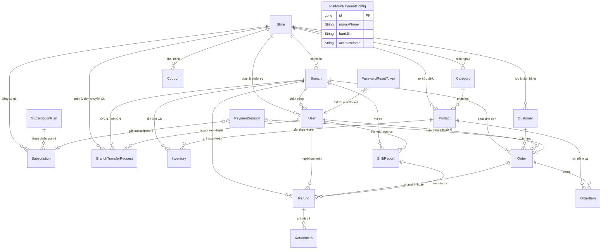

# 👗 Fashion POS AI — Multi-Tenant Retail & Point-of-Sale SaaS

> **Hệ thống Quản lý Bán lẻ & Điểm bán hàng POS Đa chi nhánh theo kiến trúc Multi-Tenant SaaS dành cho ngành Thời trang — xây dựng với Spring Boot 3.5.8, MySQL 8.0 và React 19 + Vite 7, tích hợp trợ lý AI (`gemini-2.5-flash` + động cơ phân tích Java), điều chuyển tồn kho & nhân sự liên chi nhánh, phân trang chuẩn `PageResponse<T>`, thanh toán VietQR / SePay IPN, hóa đơn PDF và kiểm soát gói cước theo Feature-Gate.**

---

## 📑 Mục Lục

1. [Tổng Quan Dự Án & Kiến Trúc Kỹ Thuật](#1-tổng-quan-dự-án--kiến-trúc-kỹ-thuật)
2. [Phân Quyền Vai Trò & Ma Trận RBAC (4 Roles)](#2-phân-quyền-vai-trò--ma-trận-rbac-4-roles)
3. [Trợ Lý AI Copilot & Động Cơ Phân Tích](#3-trợ-lý-ai-copilot--động-cơ-phân-tích)
4. [Nghiệp Vụ POS, Kho Liên Chi Nhánh, Thanh Toán & Ca Làm Việc](#4-nghiệp-vụ-pos-kho-liên-chi-nhánh-thanh-toán--ca-làm-việc)
5. [Mô Hình SaaS Subscription, Feature-Gate & Schedulers](#5-mô-hình-saas-subscription-feature-gate--schedulers)
6. [Cơ Sở Dữ Liệu & Mô Hình Thực Thể (19 JPA Entities / 20 Bảng)](#6-cơ-sở-dữ-liệu--mô-hình-thực-thể-19-jpa-entities--20-bảng)
7. [Tài Liệu REST API Toàn Diện (22 Controllers)](#7-tài-liệu-rest-api-toàn-diện-22-controllers)
8. [Phạm Vi Dữ Liệu Thực Tế & Thành Phần Cục Bộ / Dev-Only](#8-phạm-vi-dữ-liệu-thực-tế--thành-phần-cục-bộ--dev-only)
9. [Hướng Dẫn Cài Đặt, Khởi Chạy & Kiểm Thử](#9-hướng-dẫn-cài-đặt-khởi-chạy--kiểm-thử)
10. [Cấu Hình Biến Môi Trường (.env / application.properties)](#10-cấu-hình-biến-môi-trường-env--applicationproperties)
11. [Cấu Trúc Thư Mục Dự Án](#11-cấu-trúc-thư-mục-dự-án)

---

## 1. Tổng Quan Dự Án & Kiến Trúc Kỹ Thuật

```text
+---------------------------------------------------------------------------------------+
|                                   CLIENT BROWSERS                                     |
|  - Landing / Auth (/auth/login, /auth/onboarding, /auth/forgot-password, reset)       |
|  - Cashier (/cashier): POS 3 cột, F1-F4/F9/Ctrl+Enter, VietQR, Returns, Shift Summary |
|  - Branch Manager (/branch): Analytics, Orders, Refunds, Inventory, Staff, Reports    |
|  - Store Owner (/store): Branches, Inventory Transfer (/store/inventory), Products,   |
|    Categories, Employees + Transfer Review, Customers, Coupons, Alerts, Upgrade SaaS  |
|  - Super Admin (/super-admin): Moderation, Stores, Plans, Commissions, Exports        |
+-------------------------------------------+-------------------------------------------+
                                            | HTTPS / JSON (Bearer JWT + CORS)
                                            v
+---------------------------------------------------------------------------------------+
|                       FRONTEND SPA (React 19 + Vite 7 + Redux Toolkit)                |
|  - React Router v7 (AuthRoutes, CashierRoutes, BranchManagerRoutes, Store, SuperAdmin)|
|  - Redux Toolkit (19 Feature Slices) + Axios Interceptors (src/utils/api.js)          |
|  - Shared UI: DataTablePagination, FeatureGate, Tailwind CSS v4 + Radix UI + Recharts |
|  - PDF & Browser APIs: @react-pdf/renderer (OrderPDF), Web Speech API (vi-VN)         |
+-------------------------------------------+-------------------------------------------+
                                            | REST APIs (Port 5000)
                                            v
+---------------------------------------------------------------------------------------+
|                  BACKEND MONOLITH (Java 17 + Spring Boot 3.5.8 + Security 6)          |
|  - Stateless JWT (jjwt 0.12.6, revokes via passwordChangedAt & blocked/locked flags)  |
|  - 22 REST Controllers & AccessControlService (Multi-Tenant Isolation + PreAuthorize) |
|  - PlanLimitChecker (Quotas & PlanFeature Gates) & SubscriptionExpiryScheduler        |
|  - AiCopilotService (Deterministic Java Engines + Optional Gemini 2.5 Flash Summary)  |
|  - PaymentGatewayService (VietQR, SePay Webhook IPN, Dev-only 3DS/Webhook Simulator)  |
|  - AuthServiceImpl (SendGrid Web API v3 HTTPS 443 OTP + IP/Email Rate Limiter)        |
+-------------------------------------------+-------------------------------------------+
                                            | Spring Data JPA / Hibernate ORM / HikariCP
                                            v
+---------------------------------------------------------------------------------------+
|                    DATA PERSISTENCE & FILE STORAGE (MySQL 8.0 + Disk)                 |
|  - 19 JPA @Entity + 2 @Embeddable + 1 @ElementCollection => 20 bảng AUTO_INCREMENT       |
|  - DatabaseSchemaFixer (auto schema patches & legacy role/FK normalization on startup)|
|  - Local upload directory (APP_UPLOAD_DIR=uploads) for /api/media/upload & download   |
+---------------------------------------------------------------------------------------+
```

### Tech Stack Xác Minh Trực Tiếp Từ `pom.xml` & `package.json`

| Lớp | Công Nghệ Chính | Chi Tiết Phiên Bản & Thực Thi |
| :--- | :--- | :--- |
| **Backend Core** | Java 17+, Spring Boot `3.5.8` | `spring-boot-starter-web`, `data-jpa`, `security`, `validation`, Lombok (`mvn test` kiểm chứng trên OpenJDK 21.0.9) |
| **Bảo mật & JWT** | Spring Security 6, `jjwt:0.12.6` | `JwtValidator` + `JwtProvider` + BCrypt; thu hồi JWT theo `passwordChangedAt`, `loginAccess`, `StoreStatus` |
| **Cơ sở dữ liệu** | MySQL 8.0 (`mysql-connector-j`) | `20` bảng chuẩn `IDENTITY` (`AUTO_INCREMENT`), `ddl-auto=update`, `DatabaseSchemaFixer.java` chuẩn hóa khi khởi động |
| **Email OTP** | SendGrid Web API v3 | Gọi trực tiếp `https://api.sendgrid.com/v3/mail/send` qua `RestTemplate` (`AuthServiceImpl`) *(dependency `spring-boot-starter-mail` trong `pom.xml` không dùng ở runtime)* |
| **AI Copilot** | Java Engines + Gemini REST API | `gemini-2.5-flash` viết tóm tắt điều hành/ca (tùy chọn, tự fallback); engine POS/Cross-sell/Restock/Coupon chạy Java thuần |
| **Thanh toán** | VietQR + SePay IPN + Dev Sim | `img.vietqr.io`, `/api/payment-gateway/webhook/sepay` (`Apikey`), 3DS/Webhook giả lập chỉ mở ở local/dev *(`stripe-java:28.3.1` & `razorpay-java:1.4.8` chưa gọi ở runtime)* |
| **Frontend Core** | React `19.1.0`, Vite `7.0.0`, RTK `2.8.2` | `react-router:7.6.3`, `axios:1.10.0`, `lucide-react:0.525.0`, `@react-pdf/renderer:4.3.0`, `recharts:3.1.0`, `formik` / `react-hook-form` / `zod` |
| **UI & Styling** | Tailwind CSS `4.1.11`, Radix UI | `@tailwindcss/vite:4.1.11`, bộ Radix primitives (Dialog, Select, Tabs, Switch...), `sonner:2.0.5`, `DataTablePagination` |
| **Kiểm thử** | JUnit 5 + Mockito + MockMvc / Node `--test` | Backend: `43` lớp (`235/235 PASS` với MySQL `:3306`; `234/234` Unit/MockMvc cô lập); Frontend: `7` suites (`36/36 PASS`) |

---

## 2. Phân Quyền Vai Trò & Ma Trận RBAC (4 Roles)

Hệ thống định nghĩa **chính xác 4 vai trò** trong [`UserRole.java`](pos-backend/src/main/java/com/zosh/domain/UserRole.java):

| Role (`UserRole`) | Mô Tả | Legacy Mapping (`JwtValidator` & `DatabaseSchemaFixer`) |
| :--- | :--- | :--- |
| `ROLE_SUPER_ADMIN` | Quản trị toàn nền tảng SaaS | `ROLE_ADMIN` tự động chuyển về `ROLE_SUPER_ADMIN` |
| `ROLE_STORE_OWNER` | Chủ sở hữu chuỗi cửa hàng | `ROLE_STORE_ADMIN`, `ROLE_STORE_MANAGER` tự động chuyển về `ROLE_STORE_OWNER` |
| `ROLE_BRANCH_MANAGER` | Quản lý chi nhánh cụ thể (`branch_id`) | Giữ nguyên `ROLE_BRANCH_MANAGER` |
| `ROLE_CASHIER` | Thu ngân tại quầy (`branch_id`) | `ROLE_BRANCH_CASHIER` tự động chuyển về `ROLE_CASHIER` |

### Cô lập Multi-Tenant & Bảo mật Truy cập
- **Duyệt & khóa cửa hàng (`StoreStatus`):** `PENDING` ➔ `ACTIVE` / `REJECTED` (Chủ chuỗi sửa hồ sơ gửi duyệt lại ➔ `PENDING`) ➔ `BLOCKED` (khi bị khóa, `StoreServiceImpl` đóng toàn bộ ca đang mở và chặn mọi API/đăng nhập thuộc store).
- **Khóa nhân sự (`loginAccess = false`):** Tự động đóng ca đang mở của nhân viên, chặn đăng nhập mới và từ chối mọi JWT đang lưu.
- **Thu hồi JWT:** Đổi mật khẩu hoặc đặt lại mật khẩu cập nhật `passwordChangedAt`, vô hiệu hóa ngay các token phát hành trước đó.

### Ma Trận Quyền Hạn Chi Tiết

| Chức năng / Nghiệp vụ | `ROLE_SUPER_ADMIN` | `ROLE_STORE_OWNER` | `ROLE_BRANCH_MANAGER` | `ROLE_CASHIER` |
| :--- | :---: | :---: | :---: | :---: |
| Tự đăng ký tài khoản (`/auth/signup`) | — | ✅ *(Guest chọn Owner)* | ❌ *(Owner/BM tạo)* | ❌ *(Owner/BM tạo)* |
| Đăng nhập, Quên MK OTP 3 bước, Hồ sơ, Đổi MK, Upload Media | ✅ | ✅ | ✅ | ✅ |
| Store Onboarding & Gửi duyệt lại khi `REJECTED` | ✅ | ✅ *(Store của mình)* | ❌ | ❌ |
| Duyệt / Từ chối / Khóa Store (`/moderate`), Chỉnh Hoa hồng | ✅ | ❌ | ❌ | ❌ |
| CRUD Gói SaaS (`/super-admin/subscription-plans`), Platform Keys | ✅ | ❌ | ❌ | ❌ |
| Xem Gói & Entitlements, Đăng ký / Nâng cấp / Hủy Gói Store | ✅ | ✅ | Đọc Entitlements | Đọc Entitlements |
| CRUD Chi nhánh (`Branch`), Danh mục (`Category`) & Sản phẩm (`Product`) | ✅ | ✅ *(theo Plan Limit)* | ❌ *(Chỉ xem)* | ❌ *(Chỉ xem)* |
| CRUD Mã khuyến mãi (`Coupon`), Cập nhật `Store` & `taxRate` | ✅ | ✅ | ❌ *(Chỉ xem/áp)* | ❌ *(Chỉ xem/áp)* |
| Quản lý Nhân sự cấp Store & Nhân sự Chi nhánh | ✅ | ✅ *(theo `maxUsers`)* | ✅ *(Cashier cùng CN)* | ❌ |
| Xin chuyển chi nhánh (`/api/branch-transfer-requests`) | ❌ | ✅ *(Duyệt / Từ chối)* | ✅ *(Gửi / Hủy đơn)* | ✅ *(Gửi / Hủy đơn)* |
| Tồn kho Chi nhánh (`Inventory` CRUD, gate `inventory`) | ✅ | ✅ | ✅ *(cùng `branchId`)* | ❌ *(Chỉ xem)* |
| **Điều chuyển tồn kho liên chi nhánh (`/store/inventory`)** | ✅ *(API)* | ✅ **`/store/inventory` + Alerts** | ✅ *(API, từ CN mình)* | ❌ |
| Tạo Đơn POS & Thanh toán (`CASH`/`UPI`/`CARD`) | ✅ *(API)* | ✅ *(Không cần mở ca)* | ✅ *(Không cần mở ca)* | ✅ *(Bắt buộc mở ca)* |
| Giảm giá tay không Coupon tại POS | ✅ | ✅ *(Không giới hạn)* | ✅ *(Không giới hạn)* | ✅ *(Tối đa 10%)* |
| Đổi trả / Hoàn tiền (`Refund`) | ✅ *(theo ca mở)* | ✅ *(theo ca mở)* | ✅ *(theo ca mở)* | ✅ *(theo ca mở)* |
| Xóa vĩnh viễn Đơn / Phiếu hoàn / Ca (`assertStoreLevelOrAdmin`) | ✅ | ✅ | ❌ | ❌ |
| Tạo / Sửa thông tin Khách hàng & Chỉnh điểm thưởng | ✅ | ✅ | ✅ | ✅ *(Chặn sửa tay điểm)* |
| Mở / Kết Ca cá nhân (`ShiftReport`) | ✅ | ✅ | ✅ *(cùng CN/Store)* | ✅ *(ca của mình)* |
| Phân tích Chuỗi (`StoreAnalytics`), Cảnh báo & AI Store Insights | ✅ | ✅ | ❌ | ❌ |
| Phân tích Chi nhánh (`BranchAnalytics`), Báo cáo & AI Branch Insights | ✅ | ✅ | ✅ *(CN mình)* | ❌ |

---

## 3. Trợ Lý AI Copilot & Động Cơ Phân Tích

Tất cả endpoint `/api/ai/*` được bảo vệ bởi `PlanFeature.AI_COPILOT` (trừ `ROLE_SUPER_ADMIN`). Mã nguồn trong [`AiCopilotService.java`](pos-backend/src/main/java/com/zosh/service/AiCopilotService.java) kết hợp hai lớp xử lý:

| Tính năng AI | Endpoint / Component | Cơ chế thực thi trong Mã nguồn |
| :--- | :--- | :--- |
| **1. Tóm tắt Điều hành Chuỗi & CN** | `GET /api/ai/store-insights/{storeAdminId}`<br/>`GET /api/ai/branch-insights/{branchId}` | Thống kê doanh thu, tăng trưởng WoW, tỷ lệ hoàn trả trong Java; **gọi Gemini REST (`gemini-2.5-flash`)** viết `executiveSummary` (tự fallback về mẫu tiếng Việt nếu thiếu/lỗi key). |
| **2. Tóm tắt Bàn giao Ca** | `GET /api/ai/shift-summary`<br/>`ShiftAiHandoverCard.jsx` | Tổng hợp `netCashInDrawer`, tổng hoàn trả, top sản phẩm bán chạy; gọi Gemini viết `overviewParagraph` (kèm fallback). |
| **3. Lên đơn nhanh Bằng Lệnh / Giọng nói** | `POST /api/ai/pos/quick-command`<br/>`SmartPosAssistantBar.jsx` | Trình duyệt dùng **Web Speech API (`vi-VN`)**; Backend dùng chuẩn hóa tiếng Việt + Regex + Fuzzy matching trong Java để bóc tách SP, SL, khách hàng, coupon và PTTT vào giỏ Redux. |
| **4. Gợi ý Bán chéo (Cross-sell)** | `POST /api/ai/pos/cross-sell` | Thuật toán co-occurrence 30 ngày trong Java + lịch sử mua hàng + best-seller fallback, tự lọc theo tồn kho khi bật `INVENTORY`. |
| **5. Dự báo Nhập hàng (Smart Restock)** | `store-insights` / `branch-insights`<br/>Nút `+N Kho` trên UI | Tính vận tốc bán 14 ngày (`velocityPerDay`), `daysLeft` và lượng đề xuất nhập; bấm **`+N Kho`** trên UI gọi thẳng `POST /api/inventories`. |
| **6. Gợi ý Mã Khuyến mãi Xả tồn** | `store-insights` / `branch-insights`<br/>Nút `Tạo mã` trên UI | Quét hàng tồn cao bán chậm 14 ngày (`stock > 15`, bán `< 3`), đề xuất mã `XA<SKU>15` (fallback `COMBO10`); bấm **`Tạo mã`** gọi `POST /api/coupons`. |

---

## 4. Nghiệp Vụ POS, Kho Liên Chi Nhánh, Thanh Toán & Ca Làm Việc

### 4.1. Điều Chuyển Tồn Kho Liên Chi Nhánh (`/store/inventory`)
- **Giao diện trực quan cho Chủ chuỗi (`StoreInventoryTransfer.jsx`):** Truy cập từ thanh bên `Inventory Transfer` hoặc nút *"Mở trang điều chuyển kho"* tại trang `/store/alerts`; bảo vệ bởi `<FeatureGate feature="inventory">` kết hợp `<FeatureGate feature="multiLocation">`.
- **Trải nghiệm & an toàn giao dịch:** Chọn hoặc hoán đổi nhanh cặp Chi nhánh nguồn – Chi nhánh đích (`branchA <-> branchB`), xem song song tồn kho nguồn & tồn kho đích theo từng SKU có phân trang (`DataTablePagination`), các mức chọn nhanh (`5`, `10`, `20`, `50%` tồn nguồn), dự kiến số dư trước/sau (`fromBranch`, `toBranch`) qua `computeTransferPreview`, và lưu nhật ký các lần chuyển trong phiên làm việc.
- **Kiểm soát đồng thời phía Backend (`InventoryServiceImpl.transferInventory`):** Khóa bi quan `@Lock(LockModeType.PESSIMISTIC_WRITE)` theo **thứ tự `id` chi nhánh tăng dần** (`Math.min/max`) nhằm loại bỏ deadlock khi nhiều yêu cầu chuyển chéo chi nhánh diễn ra song song.

### 4.2. Yêu Cầu Chuyển Chi Nhánh Nhân Sự (`/api/branch-transfer-requests`)
- Nhân sự chi nhánh (`ROLE_BRANCH_MANAGER`, `ROLE_CASHIER`) có thể gửi đơn xin chuyển sang chi nhánh khác trong cùng Store (`POST /api/branch-transfer-requests`), theo dõi (`GET /my`) hoặc hủy đơn chờ (`PUT /{id}/cancel`).
- Chủ chuỗi xem danh sách phân trang (`GET /store/{storeId}/paged`), thống kê (`GET /store/{storeId}/summary`) và duyệt/từ chối (`PUT /{id}/review`). Khi `APPROVED`, nhân sự được cập nhật sang chi nhánh đích và tự động đóng các ca làm việc đang mở ở chi nhánh cũ.

### 4.3. Trạm POS, Thuế, Điểm Thưởng, Thanh Toán & Ca Làm Việc
- **Phím tắt POS (`CreateOrderPage.jsx`):** `F1` (tìm SP), `F2` (chiết khấu), `F3`/`F4` (khách hàng), `F9` hoặc `Ctrl + Enter` (thanh toán). Giữ đơn tạm (`heldOrders`) lưu trong Redux RAM.
- **Thuế & Chiết khấu (`OrderPricingCalculator.java` / `OrderServiceImpl.java`):** Thuế tính tại Server theo `store.taxRate` (mặc định `10%`): `(subTotal - discountAmount) * taxRate / 100`. Giảm giá thủ công của `ROLE_CASHIER` bị giới hạn tối đa `10%`.
- **Loyalty Points:** Đơn `COMPLETED` cộng `floor(totalAmount / 10,000₫)` điểm; áp `couponCode = "POINTS"` đổi `1 điểm = 1,000₫`; hoàn trả từng phần thu hồi điểm theo lũy kế `floor(totalRefunded / 10,000₫)` tránh sai số làm tròn.
- **Thanh toán Đa kênh (`PaymentGatewayService.java`):**
  - `CASH`: Chốt ngay `COMPLETED`.
  - `UPI` (VietQR / MoMo): Tạo `Order(PENDING)` + `PaymentSession` (`POSxxxxxx`), mở QR `img.vietqr.io`, trang checkout `/api/payment-gateway/checkout/{sessionId}` tự refresh 5s; đối soát Webhook SePay IPN (`Authorization: Apikey <key>`) chống trùng qua `providerTxId`.
  - `CARD`: Mô phỏng 3D-Secure (`CVV=000` để test lỗi) chỉ bật khi `isSimulationAllowed() == true` (local/dev).
- **Ca làm việc (`ShiftReportServiceImpl.java`):** Thu ngân bắt buộc mở ca trước khi bán; kết ca tổng hợp `totalSales`, `totalRefunds`, `netSale`, top 5 sản phẩm và `PaymentSummary` bất biến.
- **Phân trang chuẩn hệ thống:** Backend trả về `PageResponse<T>` trên 9 controller (Sản phẩm, Tồn kho, Đơn hàng, Hoàn trả, Ca làm việc, Khách hàng, Cửa hàng, Thuê bao, Yêu cầu chuyển nhánh); Frontend chuẩn hóa qua `paginationUtils.js` và `DataTablePagination.jsx`.

---

## 5. Mô Hình SaaS Subscription, Feature-Gate & Schedulers

Gói dịch vụ SaaS do Super Admin cấu hình động trong `subscription_plan` (`MONTHLY` = 30 ngày / `YEARLY` = 365 ngày):
- **Chế độ mặc định (`Free Starter` khi chưa đăng ký / `EXPIRED`):** Tối đa **1 chi nhánh**, **3 nhân sự**, **30 sản phẩm**, và **toàn bộ 8 cờ `PlanFeature` = `false`**.
- **Chống hạ gói vượt hạn mức (`PlanLimitChecker.java`):** Chặn chuyển gói nếu số chi nhánh / nhân sự / sản phẩm hiện vượt quota gói đích.

### Phân Tích 8 Cờ Tính Năng (`PlanFeature.java`)

| Key Cờ Tính Năng | Trạng Thái Thực Thi | Phạm Vi Áp Dụng Thực Tế |
| :--- | :---: | :--- |
| `advancedReports` | **Thực thi Backend + UI** | Mở khóa `/branch/reports`, `/store/reports` (`FeatureGate`) và API thống kê nâng cao. |
| `inventory` | **Thực thi Backend + UI** | Mở khóa `/branch/inventory`, `/store/inventory`, API `/api/inventories/**`; nếu tắt, POS vẫn bán và bỏ qua trừ/hoàn kho. |
| `multiLocation` | **Thực thi Backend + UI** | Cho phép mở từ chi nhánh thứ 2 trở lên và bắt buộc đi kèm `inventory` cho màn hình `/store/inventory` & API `/api/inventories/transfer`. |
| `invoiceBranding` | **Thực thi UI PDF** | Hiển thị nhận diện thương hiệu cửa hàng trên hóa đơn PDF (`OrderPDF.jsx`). |
| `aiCopilot` | **Thực thi Backend + UI** | Mở khóa `/api/ai/**` (trừ Super Admin bypass) và các thành phần AI Copilot trên POS / Dashboard. |
| `integrations` | *Metadata gói* | Cấu hình hiển thị bảng giá SaaS. |
| `ecommerce` | *Metadata gói* | Cấu hình hiển thị bảng giá SaaS. |
| `prioritySupport` | *Metadata gói* | Cấu hình hiển thị bảng giá SaaS. |

### Tác Vụ Lập Lịch (`SubscriptionExpiryScheduler.java`)
- **Mỗi 1 giờ (`3,600,000 ms`):** Tự động chuyển các thuê bao `ACTIVE` / `TRIAL` quá hạn sang `EXPIRED`.
- **Mỗi 5 phút (`300,000 ms`):** Tự động hủy các đơn `PENDING` quá 30 phút chưa thanh toán, hoàn lại tồn kho và điểm thưởng đã giữ.

---

## 6. Cơ Sở Dữ Liệu & Mô Hình Thực Thể (19 JPA Entities / 20 Bảng)

Hệ thống gồm **19 JPA `@Entity`**, **2 `@Embeddable`** (`StoreContact`, `StorePaymentInfo`), **1 bảng `@ElementCollection`** (`branch_working_days`) và **1 lớp POJO nhúng** (`PaymentSummary`) ➔ tạo ra **20 bảng MySQL vật lý** (tất cả khóa chính dạng số dùng chuẩn `GenerationType.IDENTITY` / `AUTO_INCREMENT`, không còn bảng sinh chuỗi `*_seq`):



### Danh Sách 19 `@Entity` & 1 Bảng Bộ Sưu Tập (20 Bảng Vật Lý)

| STT | Entity / Nguồn JPA | Bảng MySQL & Vai Trò Chính |
| :-: | :--- | :--- |
| 1 | `User` | `user` — Tài khoản 4 vai trò, `loginAccess`, `passwordChangedAt`, gắn `Store` / `Branch` |
| 2 | `PasswordResetToken` | `password_reset_tokens` — OTP 6 số, số lần thử sai, `resetTicket`, hạn 5 phút |
| 3 | `Store` | `store` — Chuỗi cửa hàng (`StoreStatus`, `taxRate`, `commissionRate`, nhúng `StoreContact` & `StorePaymentInfo`) |
| 4 | `Branch` | `branch` (+ `@ElementCollection` `branch_working_days`) — Chi nhánh, giờ mở/đóng, quản lý CN |
| 5 | `BranchTransferRequest` | `branch_transfer_requests` — Đơn xin chuyển chi nhánh (`PENDING` / `APPROVED` / `REJECTED` / `CANCELLED`) |
| 6 | `Category` | `category` — Danh mục sản phẩm thuộc `Store` |
| 7 | `Product` | `product` — Sản phẩm thời trang (`sku`, `mrp`, `sellingPrice`, `brand`, `image`, `color`, `size`) |
| 8 | `Inventory` | `inventory` — Tồn kho theo `Product` & `Branch` (`quantity`, `minStockLevel`, lock bi quan) |
| 9 | `Customer` | `customer` — Khách hàng thành viên, `loyaltyPoints` |
| 10 | `Coupon` | `coupons` — Mã giảm giá (`PERCENTAGE` / `FIXED_AMOUNT`, `minOrderValue`, thời hạn) |
| 11 | `Order` | `orders` — Đơn hàng (`PENDING`, `COMPLETED`, `PARTIALLY_REFUNDED`, `REFUNDED`, `CANCELLED`) |
| 12 | `OrderItem` | `order_item` — Từng dòng sản phẩm trong đơn (`quantity`, `price`) |
| 13 | `Refund` | `refund` — Phiếu hoàn tiền gắn `Order`, `ShiftReport`, `Branch`, `User cashier` |
| 14 | `RefundItem` | `refund_item` — Chi tiết dòng hoàn & số lượng chống hoàn vượt SL đã mua |
| 15 | `ShiftReport` | `shift_report` — Ca làm việc (`shiftStart`, `shiftEnd`, `totalSales`, `totalRefunds`, `netSale`, `totalOrders`) |
| 16 | `SubscriptionPlan` | `subscription_plan` — Cấu hình gói SaaS (giá, chu kỳ, hạn mức chi nhánh/user/SKU, 8 cờ tính năng) |
| 17 | `Subscription` | `subscription` — Thuê bao của `Store` (`ACTIVE`, `TRIAL`, `PENDING_PAYMENT`, `CANCELLED`, `EXPIRED`) |
| 18 | `PaymentSession` | `payment_sessions` — Phiên thanh toán VietQR / MoMo / 3DS Card (`referenceCode`, `providerTxId`) |
| 19 | `PlatformPaymentConfig` | `platform_payment_config` — Cấu hình ví/tài khoản ngân hàng nhận phí SaaS của Nền tảng |

---

## 7. Tài Liệu REST API Toàn Diện (22 Controllers)

Tất cả endpoint `/api/**` yêu cầu `Bearer JWT` hợp lệ, ngoại trừ các đường dẫn công khai trong `SecurityConfig.java`: `/auth/**`, `/api/media/download/**`, `GET /api/payment-gateway/checkout/**`, `POST /api/payment-gateway/webhook/**`.

<details>
<summary><b>1. AuthController (<code>/auth</code>) — Đăng ký, Đăng nhập &amp; Quên mật khẩu OTP 3 bước</b></summary>

| Method | Endpoint | Mô tả | Quyền |
| :--- | :--- | :--- | :--- |
| `POST` | `/auth/signup` | Đăng ký tài khoản mới (`ROLE_STORE_OWNER`) | Public |
| `POST` | `/auth/login` | Đăng nhập cấp JWT (chặn nhân viên khóa / Store `BLOCKED`) | Public |
| `POST` | `/auth/forgot-password` | B1: Gửi OTP 6 số qua SendGrid Web API v3 (cooldown 60s, rate-limit) | Public |
| `POST` | `/auth/verify-reset-otp` | B2: Xác thực OTP ➔ cấp `resetTicket` ngắn hạn (tối đa 5 lần sai) | Public |
| `POST` | `/auth/reset-password` | B3: Đặt lại mật khẩu qua `resetTicket` & thu hồi JWT cũ | Public |

</details>

<details>
<summary><b>2. UserController (<code>/api/users</code>), EmployeeController (<code>/api/employees</code>) &amp; BranchTransferRequestController (<code>/api/branch-transfer-requests</code>)</b></summary>

| Method | Endpoint | Mô tả | Quyền |
| :--- | :--- | :--- | :--- |
| `GET` / `PUT` | `/api/users/profile`, `/api/users/change-password` | Hồ sơ cá nhân & đổi mật khẩu (thu hồi JWT cũ) | Authenticated |
| `GET` | `/api/users/list`, `/cashier`, `/customer`, `/{id}` | Danh sách & chi tiết user theo phạm vi quyền | Authenticated |
| `POST` | `/api/employees/store/{storeId}`, `/branch/{branchId}` | Tạo nhân sự cấp chuỗi / chi nhánh (`maxUsers`) | Store Owner / BM / Admin |
| `GET` / `PUT` / `DELETE` | `/api/employees/store/{id}`, `/branch/{id}`, `/{id}` | Quản lý danh sách nhân sự, `loginAccess`, đổi MK hộ | Store / Branch Scope |
| `POST` / `GET` / `PUT` | `/api/branch-transfer-requests`, `/my`, `/{id}/cancel` | Gửi, xem lịch sử & hủy đơn xin chuyển chi nhánh | BM / Cashier |
| `GET` / `PUT` | `/api/branch-transfer-requests/store/{storeId}` (`/paged`, `/summary`), `/{id}/review` | Danh sách phân trang, tổng hợp & duyệt/từ chối đơn chuyển CN | `ROLE_STORE_OWNER` |

</details>

<details>
<summary><b>3. StoreController (<code>/api/stores</code>) &amp; BranchController (<code>/api/branches</code>)</b></summary>

| Method | Endpoint | Mô tả | Quyền |
| :--- | :--- | :--- | :--- |
| `POST` | `/api/stores` | Khởi tạo Store Onboarding (`PENDING`) | `STORE_OWNER`, `SUPER_ADMIN` |
| `GET` | `/api/stores`, `/paged`, `/summary`, `/admin`, `/employee`, `/{id}` | Tra cứu Store phân trang (`PageResponse<T>`), tổng hợp & hồ sơ | Authenticated |
| `PUT` / `DELETE` | `/api/stores/{id}`, `/{id}/moderate`, `DELETE /api/stores/{id}` | Cập nhật Store, duyệt/khóa/hoa hồng (`SUPER_ADMIN`) & xóa Store | Owner / `SUPER_ADMIN` |
| `POST` / `GET` / `PUT` / `DELETE` | `/api/branches`, `/store/{storeId}`, `/{id}` | CRUD Chi nhánh (kiểm tra `multiLocation` & `maxBranches`) | Store Owner / Branch Scope |

</details>

<details>
<summary><b>4. CategoryController (<code>/api/categories</code>), ProductController (<code>/api/products</code>), InventoryController (<code>/api/inventories</code>) &amp; FileController (<code>/api/media</code>)</b></summary>

| Method | Endpoint | Mô tả | Quyền |
| :--- | :--- | :--- | :--- |
| `POST` / `GET` / `PUT` / `DELETE` | `/api/categories`, `/store/{storeId}`, `/{id}` | CRUD Danh mục sản phẩm thời trang | Store Owner / Admin (Write) |
| `POST` / `GET` / `PUT` / `PATCH` / `DELETE` | `/api/products`, `/store/{storeId}`, `/store/{storeId}/paged`, `/store/{storeId}/search` | CRUD Sản phẩm (phân trang `PageResponse`, tìm keyword/SKU, quota `maxProducts`) | Store Owner / Admin (Write) |
| `POST` / `GET` / `PUT` / `DELETE` | `/api/inventories`, `/branch/{branchId}`, `/branch/{branchId}/paged`, `/branch/{branchId}/summary`, `/product/{pId}` | Tồn kho chi nhánh phân trang & tổng hợp (`inventory` gate) | Store Owner / BM / Admin |
| `POST` | `/api/inventories/transfer` | Điều chuyển tồn kho liên chi nhánh (khóa chống deadlock, `inventory + multiLocation`, UI tại `/store/inventory`) | Store Owner / BM / Admin |
| `POST` / `GET` | `/api/media/upload`, `/api/media/download/{fileName}` | Upload file cục bộ (`<= 5MB`) & tải inline | Auth Upload / Public Download |

</details>

<details>
<summary><b>5. OrderController (<code>/api/orders</code>), RefundController (<code>/api/refunds</code>), ShiftReportController (<code>/api/shift-reports</code>), CustomerController &amp; CouponController</b></summary>

| Method | Endpoint | Mô tả | Quyền |
| :--- | :--- | :--- | :--- |
| `POST` / `PATCH` / `PUT` | `/api/orders`, `/{id}/status` | Tạo đơn (`PENDING`/`COMPLETED`) & chốt/hủy đơn (tính thuế/điểm/trừ kho server) | POS Roles (Cashier cần mở ca) |
| `GET` / `DELETE` | `/api/orders/{id}`, `/branch/{id}` (`/paged`), `/cashier/{id}` (`/paged`), `/today/branch/{id}`, `/customer/{id}`, `/recent/{branchId}` | Tra cứu đơn phân trang & xóa đơn (`assertStoreLevelOrAdmin`) | Branch Scope / Store Owner |
| `POST` / `GET` / `DELETE` | `/api/refunds`, `/branch/{id}` (`/paged`), `/cashier/{id}`, `/order/{id}`, `/shift/{id}` | Hoàn trả toàn phần/từng phần, hoàn kho & lũy kế điểm | POS Roles (cần ca mở) |
| `POST` / `PATCH` / `GET` / `DELETE` | `/api/shift-reports/start`, `/end`, `/current`, `/paged`, `/branch/{id}/paged`, `/cashier/{id}/paged` | Mở/kết ca làm việc & tra cứu phân trang ca | POS Roles / Branch Scope |
| `GET` / `POST` / `PUT` / `DELETE` | `/api/customers`, `/paged`, `/summary`, `/search`, `/{id}` | Quản lý khách hàng phân trang (`CASHIER` bị chặn sửa `loyaltyPoints`) | Authenticated in Store |
| `POST` / `GET` / `PUT` / `DELETE` | `/api/coupons`, `/store/{storeId}`, `/apply?code=&storeId=` | CRUD Coupon & kiểm tra áp mã giảm giá | Owner CRUD / POS Apply |

</details>

<details>
<summary><b>6. Analytics &amp; AI Controllers (<code>/api/branch-analytics</code>, <code>/api/store/analytics</code>, <code>/api/ai</code>)</b></summary>

| Method | Endpoint | Mô tả | Quyền |
| :--- | :--- | :--- | :--- |
| `GET` | `/api/branch-analytics/today-overview`, `/daily-sales`, `/top-products`, `/top-cashiers`, `/category-sales`, `/payment-breakdown` | 6 API thống kê chi nhánh | BM / Store Owner / Admin |
| `GET` | `/api/store/analytics/{storeAdminId}/overview`, `/sales-trends`, `/sales/daily`, `/sales/monthly`, `/sales/category`, `/sales/payment-method`, `/sales/branch`, `/payments`, `/branch-performance`, `/alerts` | 10 API phân tích toàn chuỗi & cảnh báo vận hành | Store Owner / Super Admin |
| `GET` / `POST` | `/api/ai/store-insights/{id}`, `/branch-insights/{id}`, `/shift-summary`, `/pos/quick-command`, `/pos/cross-sell` | Điều hành AI Copilot (`gemini-2.5-flash` + fallback + Java engines) | Gate `aiCopilot` + Scope |

</details>

<details>
<summary><b>7. PaymentGatewayController (<code>/api/payment-gateway</code>), SubscriptionController, SubscriptionPlanController &amp; SuperAdminDashboardController</b></summary>

| Method | Endpoint | Mô tả | Quyền |
| :--- | :--- | :--- | :--- |
| `GET` / `PUT` | `/api/payment-gateway/platform-config` | Đọc / Cập nhật cấu hình VietQR & MoMo nền tảng | Auth GET / `SUPER_ADMIN` PUT |
| `POST` / `GET` / `PUT` | `/api/payment-gateway/sessions`, `/{sessionId}`, `.../link-order`, `.../link-subscription`, `/checkout/{sessionId}` | Quản lý phiên thanh toán & trang HTML VietQR tự làm mới 5s | Authenticated / Public Checkout |
| `POST` | `/api/payment-gateway/sessions/{sessionId}/authorize-card`, `/webhook/sepay`, `/webhook/{sessionId}` | Thẻ 3DS dev simulator & Webhook IPN SePay (`Apikey`) | Dev-only Sim / Webhook Auth |
| `GET` / `POST` / `PUT` / `DELETE` | `/api/super-admin/subscription-plans`, `/{id}` | Xem gói (Auth GET) & CRUD gói SaaS (`SUPER_ADMIN`) | Auth GET / `SUPER_ADMIN` Write |
| `GET` / `POST` / `PUT` | `/api/subscriptions/entitlements`, `/store/{storeId}`, `/subscribe`, `/upgrade`, `/{id}/cancel`, `/admin`, `/admin/paged`, `/{id}/activate`, `/{id}/payment-status` | Kiểm tra quyền lợi, đăng ký, nâng cấp, hủy & quản trị thuê bao phân trang | Store Scope / `SUPER_ADMIN` |
| `GET` | `/api/super-admin/dashboard/summary`, `/store-registrations`, `/store-status-distribution` | Thống kê tổng quan nền tảng | `SUPER_ADMIN` |

</details>

---

## 8. Phạm Vi Dữ Liệu Thực Tế & Thành Phần Cục Bộ / Dev-Only

| Thành phần / Tệp | Hiện trạng thực tế trong Mã nguồn |
| :--- | :--- |
| **Landing Page (`ContactSection.jsx`, `MobileAppShowcase.jsx`, `FAQSection.jsx`)** | Form liên hệ dùng `setTimeout` giả lập trạng thái gửi thành công (hiện SĐT mẫu `+91`), nút tải app hiện toast thông báo. |
| **Cài đặt Quản lý Chi nhánh (`Branch Manager/Settings/Settings.jsx`)** | Tab **Branch Info** lưu thật xuống MySQL (`PUT /api/branches/{id}`); các tab **Printer, Tax, Payment, Discount** lưu tại `localStorage` trình duyệt. |
| **Cài đặt Chuỗi (`store/Settings/Settings.jsx`)** | **Store Info, `taxRate`, PaymentSettings, Đổi MK** lưu thật xuống MySQL; **NotificationSettings & SecuritySettings** lưu cục bộ (`pos_store_preferences`). |
| **Cài đặt & Export Super Admin (`SuperAdminDashboard/settings/*`, `ExportsPage.jsx`)** | **PlatformPaymentConfig, Profile, Change Password** gọi API lưu MySQL; **Notification/System Settings** lưu `localStorage`; `ExportsPage.jsx` xuất CSV trực tiếp trên trình duyệt. |
| **Chuông thông báo Topbar (`BranchManagerTopbar.jsx`, `StoreTopbar.jsx`)** | Badge thông báo mẫu tĩnh trên giao diện header. |
| **Nhãn thuế trên Modal Thanh toán (`PaymentDialog.jsx`)** | Nhãn text hiển thị cố định `"Thuế VAT (10%):"` dù giá trị tính toán thực tế đọc động từ `store.taxRate`. |
| **Giỏ hàng tạm (`cartSlice.heldOrders`)** | Lưu trên RAM Redux trình duyệt (khác với đơn chờ `PENDING` trong MySQL). |
| **Cổng 3D-Secure & Webhook giả lập (`PaymentGatewayService`)** | Tự động vô hiệu hóa trên môi trường `prod` hoặc domain public (`isSimulationAllowed()`). |
| **Dependencies & tệp cũ chưa dùng ở runtime** | `stripe-java`, `razorpay-java` trong `pom.xml`; `spring.mail.*` SMTP (thực tế gửi qua SendGrid Web API v3); `ShiftSummary/data/mockShiftData.js`; `cashier/Sidebar/navItems.js`. |

---

## 9. Hướng Dẫn Cài Đặt, Khởi Chạy & Kiểm Thử

### Yêu Cầu Môi Trường
- **JDK 17+** & **Apache Maven (`mvn`)** *(lưu ý `pos-backend/` không kèm `mvnw`, cần có `mvn` trong `PATH`)*.
- **Node.js 18+** & **npm**.
- **Docker & Docker Compose** (hoặc MySQL 8.0 chạy tại cổng `3306`).

### Bước 1: Khởi động MySQL 8.0 & Nạp Dữ Liệu Mẫu (Tùy chọn)
```bash
docker-compose up -d
```
Container `pos-mysql` mở cổng `3306` với database `pos`, tài khoản `root` / `root`.

Nếu sử dụng bộ kịch bản SQL chuẩn Hibernate 6 (`20` bảng `AUTO_INCREMENT`) trong thư mục `database/` (đi kèm trong gói đóng gói `D:\TaiLieu\BTL\fashion_pos_ai\database\` hoặc `D:\TaiLieu\BTL\Database\`):
- Mở **MySQL Workbench** / **DBeaver**, mở tệp **`FashionPOS_AI_Full_Database.sql`** và nhấn **Execute SQL Script** để thực thi toàn bộ tập lệnh (hoặc nạp qua CLI `mysql -u root -p < database/FashionPOS_AI_Full_Database.sql`, hay chạy tách `01_schema.sql` ➔ `02_seed_data.sql`).
- Kết quả khởi tạo gồm: **2 Store ACTIVE**, **4 Chi nhánh**, **12 User 4 vai trò**, **14 Danh mục**, **240 Sản phẩm SKU**, **480 bản ghi Tồn kho (`quantity = 99`)**, **100 Khách hàng**, **20 Mã giảm giá**, **32 Ca làm việc**, **200 Đơn hàng (450 dòng SP)**, **6 Phiếu hoàn trả** và **4 Đơn chuyển chi nhánh**.

**Tài khoản Demo hiển thị trên màn hình Đăng nhập (Mật khẩu chung: `123456`):**
- **Super Admin:** `admin@yopmail.com`
- **Store Admin:** `storeadmin1@yopmail.com` *(Store 1)* | `storeadmin2@yopmail.com` *(Store 2 — trong seed SQL)*
- **Branch Manager:** `manager.b1@yopmail.com` *(CN 1)* | `manager.b2@yopmail.com` *(CN 2 — trong seed SQL)*
- **Cashier:** `cashier.b1@yopmail.com` *(CN 1)* | `cashier.b2@yopmail.com` *(CN 2 — trong seed SQL)*

### Bước 2: Khởi chạy & Kiểm thử Backend (`http://localhost:5000`)
```bash
cd pos-backend
mvn spring-boot:run
```
Chạy toàn bộ kiểm thử Backend (`43` lớp / `235/235 PASS` khi MySQL `:3306` đang chạy) hoặc chỉ chạy Unit & MockMvc cô lập (`42` lớp / `234/234 PASS`):
```bash
# Đầy đủ (kèm @SpringBootTest kết nối MySQL :3306):
mvn test

# Chỉ Unit & MockMvc (không cần MySQL đang chạy):
mvn test "-Dtest=!ZoshPosSystemApplicationTests"
```

### Bước 3: Khởi chạy, Kiểm thử & Build Frontend (`http://localhost:5173`)
```bash
cd pos-frontend
npm install
npm run dev
```
Chạy bộ kiểm thử đơn vị Frontend, kiểm tra ESLint & đóng gói Production (`7 suites` -> `36/36 PASS`, `3352 modules` Vite build):
```bash
npm test
npm run lint
npm run build
```

---

## 10. Cấu Hình Biến Môi Trường (.env / application.properties)

### Backend (`pos-backend/src/main/resources/application.properties` & Env Vars)

| Biến Môi Trường | Giá Trị Mặc Định | Ghi Chú Thực Tế Trong Code |
| :--- | :--- | :--- |
| `SERVER_PORT` | `5000` | Cổng HTTP của Spring Boot. |
| `DB_URL` | `jdbc:mysql://localhost:3306/pos?...` | JDBC URL MySQL (`createDatabaseIfNotExist=true`, `serverTimezone=UTC`). |
| `DB_USERNAME` / `DB_PASSWORD` | `root` / `root` | Thông tin đăng nhập MySQL. |
| `SPRING_PROFILES_ACTIVE` | `dev` | Nếu chứa `prod`/`production`, bắt buộc `JWT_SECRET` >= 32 bytes và **tắt mô phỏng thanh toán**. |
| `JWT_SECRET` | *(Trống ở `dev`: tự sinh tạm)* | Khóa HMAC-SHA ký JWT (bắt buộc ở `prod`). |
| `FRONTEND_URL` | `http://localhost:5173` | Domain Frontend cho CORS & kiểm tra `isSimulationAllowed()`. |
| `APP_BACKEND_URL` | *(trống)* | Public URL Backend tạo `mobileCheckoutUrl`. |
| `APP_TRUST_PROXY` | `false` | Đặt `true` nếu sau Reverse Proxy để lấy đúng IP cho rate-limit OTP. |
| `GEMINI_API_KEY` / `GEMINI_MODEL` | *(trống)* / `gemini-2.5-flash` | Bật sinh tóm tắt Gemini AI (tự fallback nếu bỏ trống). |
| `MAIL_PASSWORD` | `abcd` | Thay bằng **SendGrid API Key (`SG.xxx`)** cho Web API v3 gửi OTP. |
| `MAIL_FROM` / `MAIL_FROM_NAME` | `posfrom@yopmail.com` / `posfrom` | Email & tên người gửi SendGrid. |
| `SEPAY_API_KEY` | *(trống)* | Khóa `Authorization: Apikey <key>` xác thực SePay Webhook IPN. |
| `APP_PAYMENT_ENABLE_SIMULATION` | `false` | Cho phép mô phỏng thanh toán cục bộ; bị chặn ở `prod` / domain public. |
| `APP_UPLOAD_DIR` | `uploads` | Thư mục lưu tệp tải lên `/api/media/upload` (`<= 5MB`). |

### Frontend (`pos-frontend/.env`)

```properties
VITE_API_URL=http://localhost:5000

# Tùy chọn Cloudinary (nếu bỏ trống sẽ tự fallback sang POST /api/media/upload của Backend):
VITE_CLOUDINARY_CLOUD_NAME=
VITE_CLOUDINARY_UPLOAD_PRESET=
```

---

## 11. Cấu Trúc Thư Mục Dự Án

```text
fashion_pos_ai/
├── database/                       # Bộ script SQL DDL + Seed chuẩn Hibernate 6 (trong gói nộp bài / Database)
│   ├── 01_schema.sql
│   ├── 02_seed_data.sql
│   └── FashionPOS_AI_Full_Database.sql
├── docker-compose.yml              # MySQL 8.0 container (db: pos, port: 3306)
├── docs/images/                    # Ảnh giao diện tham khảo
├── pos-backend/
│   ├── Dockerfile                  # Multi-stage Maven -> JRE 17 Alpine (-Xmx256m)
│   ├── pom.xml                     # Spring Boot 3.5.8, Security 6, JPA, jjwt 0.12.6
│   └── src/
│       ├── main/java/com/zosh/
│       │   ├── configuration/      # SecurityConfig, JwtValidator, JwtProvider, DatabaseSchemaFixer
│       │   ├── controller/         # 22 REST Controllers (hỗ trợ Pageable / PageResponse<T>)
│       │   ├── domain/             # Enums (UserRole, PlanFeature, OrderStatus, StoreStatus, ...)
│       │   ├── modal/              # 19 @Entity + 2 @Embeddable + PaymentSummary
│       │   ├── repository/         # Spring Data JPA Repositories + Pessimistic Locks
│       │   └── service/            # AccessControlService, PlanLimitChecker, AiCopilotService & Impls
│       └── test/java/com/zosh/     # 43 lớp kiểm thử (42 Unit/MockMvc + 1 @SpringBootTest)
└── pos-frontend/
    ├── package.json                # React 19.1, Vite 7.0, Redux Toolkit 2.8.2, Tailwind v4, Radix UI
    └── src/
        ├── Redux Toolkit/features/ # 19 Feature Slices & Async Thunks
        ├── components/             # UI Primitives, FeatureGate, AI Copilot Cards, DataTablePagination
        ├── pages/                  # common (Landing, Auth, Onboarding, Customers), cashier, branch, store (gồm Inventory Transfer), superAdmin
        ├── routes/                 # AuthRoutes, CashierRoutes, BranchManagerRoutes, StoreRoutes, SuperAdminRoutes
        └── utils/                  # api.js, paginationUtils.js, paymentGatewayUtils.js, upload helpers & *.test.js
```

---

## 📄 Giấy Phép (License)

Dự án phát hành theo giấy phép **MIT License**.
