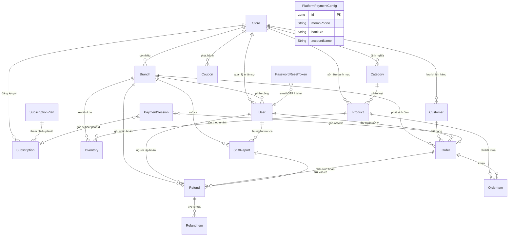
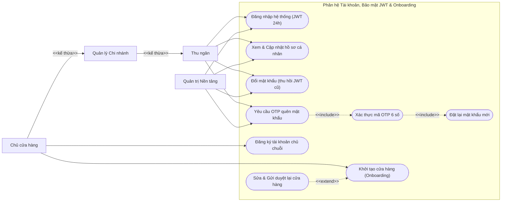
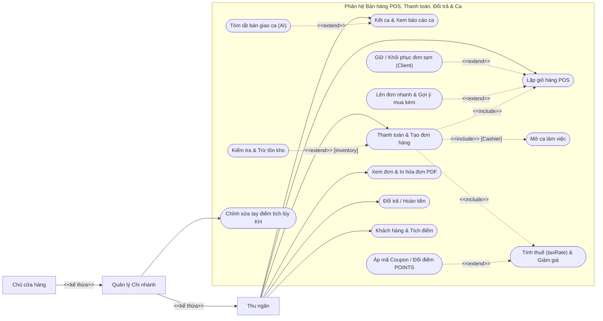
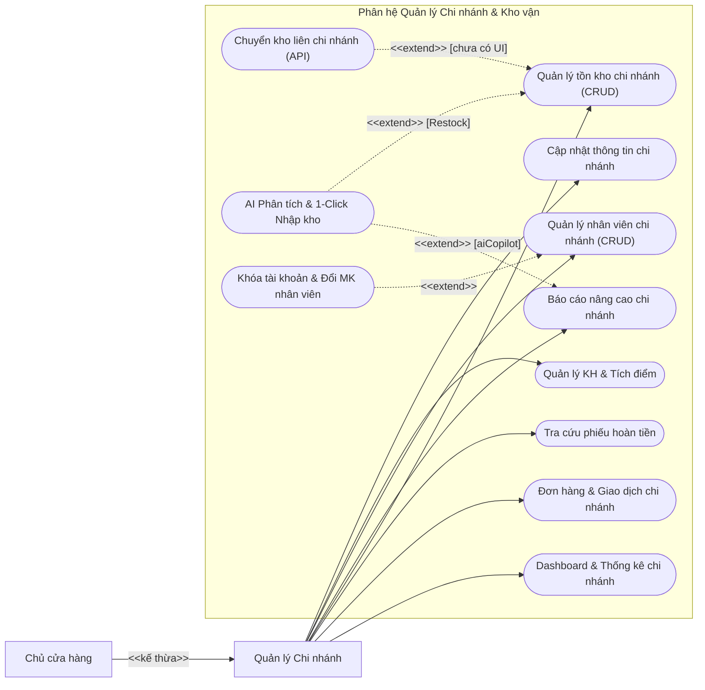
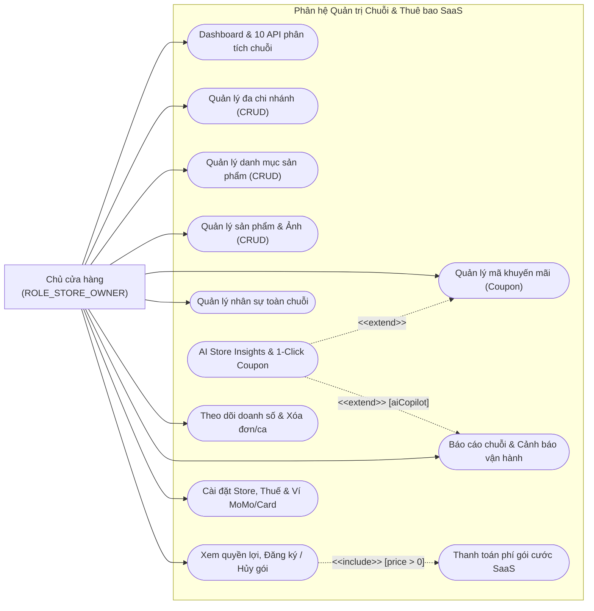
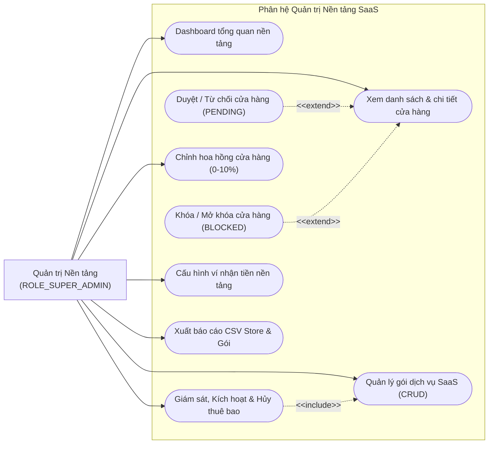

# 👗 Fashion POS AI — Multi-Tenant Retail & Point-of-Sale SaaS

> **Hệ thống Quản lý Bán lẻ & Điểm bán hàng POS Đa chi nhánh theo kiến trúc Multi-Tenant SaaS dành cho ngành Thời trang — xây dựng bằng Spring Boot 3.5.8, MySQL 8.0 và React 19 + Vite 7, tích hợp trợ lý AI (Google Gemini 2.5 Flash + động cơ phân tích Java), thanh toán VietQR / SePay IPN, hóa đơn PDF và kiểm soát gói cước theo Feature-Gate.**

---

## 📑 Mục Lục

1. [Tổng Quan Dự Án & Kiến Trúc Kỹ Thuật](#1-tổng-quan-dự-án--kiến-trúc-kỹ-thuật)
2. [Phân Quyền Vai Trò & Ma Trận RBAC (4 Roles)](#2-phân-quyền-vai-trò--ma-trận-rbac-4-roles)
3. [Trợ Lý AI Copilot & Động Cơ Phân Tích](#3-trợ-lý-ai-copilot--động-cơ-phân-tích)
4. [Nghiệp Vụ POS, Thanh Toán, Thuế, Điểm Thưởng & Ca Làm Việc](#4-nghiệp-vụ-pos-thanh-toán-thuế-điểm-thưởng--ca-làm-việc)
5. [Mô Hình SaaS Subscription, Feature-Gate & Schedulers](#5-mô-hình-saas-subscription-feature-gate--schedulers)
6. [Cơ Sở Dữ Liệu & Mô Hình Thực Thể (18 JPA Entities)](#6-cơ-sở-dữ-liệu--mô-hình-thực-thể-18-jpa-entities)
7. [Tài Liệu REST API Toàn Diện (21 Controllers)](#7-tài-liệu-rest-api-toàn-diện-21-controllers)
8. [Biểu Đồ Use Case Tổng Quát & Phân Rã](#8-biểu-đồ-use-case-tổng-quát--phân-rã)
9. [Phạm Vi Dữ Liệu Thực Tế & Thành Phần Giả Lập / Client-Only](#9-phạm-vi-dữ-liệu-thực-tế--thành-phần-giả-lập--client-only)
10. [Hướng Dẫn Cài Đặt & Khởi Chạy](#10-hướng-dẫn-cài-đặt--khởi-chạy)
11. [Cấu Hình Biến Môi Trường (.env / application.properties)](#11-cấu-hình-biến-môi-trường-env--applicationproperties)
12. [Cấu Trúc Thư Mục & Ảnh Minh Họa Hiện Có](#12-cấu-trúc-thư-mục--ảnh-minh-họa-hiện-có)

---

## 1. Tổng Quan Dự Án & Kiến Trúc Kỹ Thuật

```text
+---------------------------------------------------------------------------------------+
|                                   CLIENT BROWSERS                                     |
|  - Landing / Auth & Reset OTP / Store Onboarding                                      |
|  - Cashier POS (/cashier): F1-F4, F9, Ctrl+Enter, HeldOrders (Redux), PDF Receipt     |
|  - Branch Manager (/branch): Branch Analytics, Orders, Refunds, Inventory, Staff      |
|  - Store Owner (/store): Branches, Catalog, Coupons, Alerts, AI Insights, SaaS Upgrade|
|  - Super Admin (/super-admin): Store Moderation, Commissions, Plans, Platform Keys    |
+-------------------------------------------+-------------------------------------------+
                                            | HTTPS / JSON (Bearer JWT + CORS)
                                            v
+---------------------------------------------------------------------------------------+
|                       FRONTEND SPA (React 19 + Vite 7 + Redux Toolkit)                |
|  - React Router v7 (AuthRoutes, CashierRoutes, BranchManagerRoutes, Store, SuperAdmin)|
|  - Redux Toolkit (15 Feature Slices & Async Thunks) + Axios Interceptors (utils/api)  |
|  - UI: Tailwind CSS v4 + Radix UI Primitives + Recharts + @react-pdf/renderer         |
|  - Client Browser APIs: Web Speech API (vi-VN), Cloudinary Unsigned Upload            |
+-------------------------------------------+-------------------------------------------+
                                            | REST APIs (Port 5000)
                                            v
+---------------------------------------------------------------------------------------+
|                  BACKEND MONOLITH (Java 17 + Spring Boot 3.5.8 + Security 6)          |
|  - Stateless JWT (jjwt 0.12.6, revokes via passwordChangedAt & blocked/locked flags)  |
|  - 21 REST Controllers & AccessControlService (Multi-Tenant Isolation + Method Sec)   |
|  - PlanLimitChecker (Quotas & PlanFeature Gates) & SubscriptionExpiryScheduler        |
|  - AiCopilotService (Deterministic Java Engines + Optional Gemini 2.5 Flash Summary)  |
|  - PaymentGatewayService (VietQR, SePay Webhook IPN, Dev-only 3DS/Webhook Simulator)  |
|  - AuthServiceImpl (SendGrid Web API v3 HTTPS 443 OTP + IP/Email Rate Limiter)        |
+-------------------------------------------+-------------------------------------------+
                                            | Spring Data JPA / Hibernate ORM / HikariCP
                                            v
+---------------------------------------------------------------------------------------+
|                    DATA PERSISTENCE & FILE STORAGE (MySQL 8.0 + Disk)                 |
|  - 18 JPA @Entity + 2 @Embeddable (StoreContact, StorePaymentInfo)                    |
|  - DatabaseSchemaFixer (auto schema patches & legacy role/FK normalization on startup)|
|  - Local upload directory (APP_UPLOAD_DIR=uploads) for /api/media/upload & download   |
+---------------------------------------------------------------------------------------+
```

### Tech Stack Thực Tế Theo Mã Nguồn

| Lớp | Công Nghệ Chính | Chi Tiết Xác Minh Trong `pom.xml` / `package.json` |
| :--- | :--- | :--- |
| **Backend Core** | Java 17, Spring Boot 3.5.8 | `spring-boot-starter-web`, `data-jpa`, `security`, `validation`, Lombok |
| **Bảo mật & JWT** | Spring Security 6, `jjwt:0.12.6` | `JwtValidator` + `JwtProvider` + BCrypt; kiểm tra `passwordChangedAt`, `loginAccess`, `StoreStatus` |
| **Cơ sở dữ liệu** | MySQL 8.0 (`mysql-connector-j`) | `ddl-auto=update`, `DatabaseSchemaFixer.java` vá cột, enum & ràng buộc khi khởi động |
| **Email OTP** | SendGrid Web API v3 | Gọi trực tiếp `https://api.sendgrid.com/v3/mail/send` qua `RestTemplate` (`AuthServiceImpl`). *(Thư viện `spring-boot-starter-mail` có trong `pom.xml` nhưng không gọi ở runtime)* |
| **AI Copilot** | Java Engines + Gemini API | Gemini `gemini-2.5-flash` qua REST viết tóm tắt điều hành/ca (tùy chọn); các engine POS/Cross-sell/Restock/Coupon chạy thuật toán Java thuần |
| **Thanh toán** | VietQR + SePay Webhook + Sim Dev | `img.vietqr.io`, `api.qrserver.com`, `/webhook/sepay` (`Apikey`), + mô phỏng 3DS/Webhook chỉ bật trên môi trường dev/local (`isSimulationAllowed()`). *(`stripe-java:28.3.1` và `razorpay-java:1.4.8` có trong `pom.xml` nhưng chưa gọi ở runtime)* |
| **Frontend Core** | React 19.1, Vite 7.1, Redux Toolkit 2.8.2 | `react-router:7.9`, `axios:1.12`, `lucide-react`, `@react-pdf/renderer:4.3`, `recharts:3.1` |
| **UI & Styling** | Tailwind CSS v4, Radix UI | `@tailwindcss/vite`, Radix Dialog/Select/Tabs/Toast/Dropdown/Popover/Switch |
| **DevOps** | Docker Compose, Dockerfile | `docker-compose.yml` (`mysql:8.0` port `3306`, db `pos`); `Dockerfile` Multi-stage Maven -> JRE 17 Alpine (`-Xmx256m`) |

---

## 2. Phân Quyền Vai Trò & Ma Trận RBAC (4 Roles)

Hệ thống định nghĩa **chính xác 4 vai trò** trong [`UserRole.java`](pos-backend/src/main/java/com/zosh/domain/UserRole.java):

| Role (`UserRole`) | Mô Tả | Legacy Mapping (`JwtValidator` & `DatabaseSchemaFixer`) |
| :--- | :--- | :--- |
| `ROLE_SUPER_ADMIN` | Quản trị toàn sàn SaaS | Chuỗi cũ `ROLE_ADMIN` tự động chuyển về `ROLE_SUPER_ADMIN` |
| `ROLE_STORE_OWNER` | Chủ sở hữu chuỗi cửa hàng | `ROLE_STORE_ADMIN`, `ROLE_STORE_MANAGER` tự động chuyển về `ROLE_STORE_OWNER` |
| `ROLE_BRANCH_MANAGER` | Quản lý chi nhánh cụ thể (`branch_id`) | Giữ nguyên `ROLE_BRANCH_MANAGER` |
| `ROLE_CASHIER` | Thu ngân tại quầy (`branch_id`) | `ROLE_BRANCH_CASHIER` tự động chuyển về `ROLE_CASHIER` |

### Cô lập Multi-Tenant & Bảo mật Truy cập (`AccessControlService` + `JwtValidator`)
- **Duyệt cửa hàng (`StoreStatus`):** `PENDING` ➔ `ACTIVE` / `REJECTED` (Chủ chuỗi sửa tên/mô tả gửi duyệt lại ➔ `PENDING`) ➔ `BLOCKED` (khi bị khóa, `StoreServiceImpl` tự động đóng toàn bộ ca làm việc đang mở của cửa hàng và từ chối đăng nhập/API của mọi nhân sự thuộc store).
- **Khóa nhân viên (`loginAccess = false`):** Khi bị tắt, `EmployeeServiceImpl` tự đóng ca đang mở của nhân viên đó, `AuthServiceImpl` chặn đăng nhập mới và `JwtValidator` từ chối mọi JWT đang lưu.
- **Thu hồi JWT hàng loạt:** Đổi mật khẩu hoặc đặt lại mật khẩu cập nhật `passwordChangedAt`, khiến mọi JWT phát hành trước thời điểm đó mất hiệu lực ngay (`JwtValidator`).

### Ma Trận Quyền Hạn Chi Tiết (Đối Chiếu Từ Controllers & Services)

| Chức năng / Nghiệp vụ | `ROLE_SUPER_ADMIN` | `ROLE_STORE_OWNER` | `ROLE_BRANCH_MANAGER` | `ROLE_CASHIER` |
| :--- | :---: | :---: | :---: | :---: |
| Tự đăng ký tài khoản (`/auth/signup`) | — | ✅ *(Guest chọn Owner)* | ❌ *(Do Owner/BM tạo)* | ❌ *(Do Owner/BM tạo)* |
| Đăng nhập, Quên MK OTP 3 bước, Hồ sơ, Đổi MK, Upload Media | ✅ | ✅ | ✅ | ✅ |
| Khởi tạo Store Onboarding & Gửi duyệt lại khi `REJECTED` | ✅ | ✅ *(Store của mình)* | ❌ | ❌ |
| Duyệt / Từ chối / Khóa / Mở khóa Store (`/moderate`), Chỉnh Hoa hồng | ✅ | ❌ | ❌ | ❌ |
| Tạo / Sửa / Xóa Gói SaaS (`/super-admin/subscription-plans`), Platform Keys | ✅ | ❌ | ❌ | ❌ |
| Xem Danh sách Gói & Entitlements, Đăng ký / Nâng cấp / Hủy Gói Store | ✅ | ✅ | Chỉ đọc Entitlements | Chỉ đọc Entitlements |
| Tạo / Xóa Chi nhánh (`Branch`), Quản lý Danh mục (`Category`) & Sản phẩm (`Product`) | ✅ | ✅ *(theo Plan Limit)* | ❌ *(Chỉ xem)* | ❌ *(Chỉ xem)* |
| CRUD Mã khuyến mãi (`Coupon`), Cập nhật `Store` & `taxRate` | ✅ | ✅ | ❌ *(Chỉ xem/áp)* | ❌ *(Chỉ xem/áp)* |
| Quản lý Nhân sự cấp Store & Tạo/Sửa Quản lý Chi nhánh | ✅ | ✅ *(theo `maxUsers`)* | ❌ | ❌ |
| Tạo/Sửa/Khóa/Đặt lại MK Thu ngân (`ROLE_CASHIER`) trong Chi nhánh | ✅ | ✅ | ✅ *(cùng `branchId`)* | ❌ |
| Điều chỉnh Tồn kho Chi nhánh (`Inventory` CRUD, gate `inventory`) | ✅ | ✅ | ✅ *(cùng `branchId`)* | ❌ *(Chỉ xem)* |
| Chuyển kho nội bộ (`/api/inventories/transfer`, gate `inventory + multiLocation`) | ✅ *(API)* | ✅ *(API)* | ✅ *(API, từ CN mình)* | ❌ |
| Tạo Đơn POS & Thanh toán (`CASH`/`UPI`/`CARD`) | ✅ *(API)* | ✅ *(Không cần mở ca)* | ✅ *(Không cần mở ca)* | ✅ *(Bắt buộc mở ca)* |
| Giảm giá tay không cần Coupon tại POS | ✅ | ✅ *(Không giới hạn)* | ✅ *(Không giới hạn)* | ✅ *(Tối đa 10%)* |
| Đổi trả / Hoàn tiền (`Refund`) | ✅ *(theo ca đang mở)* | ✅ *(theo ca đang mở)* | ✅ *(theo ca đang mở)* | ✅ *(theo ca đang mở)* |
| Xóa vĩnh viễn Đơn hàng / Phiếu hoàn / Ca (`assertStoreLevelOrAdmin`) | ✅ | ✅ | ❌ | ❌ |
| Tạo / Sửa thông tin cơ bản Khách hàng (`Customer`) | ✅ | ✅ | ✅ | ✅ |
| Chỉnh sửa tay Điểm tích lũy Khách hàng (`loyaltyPoints`) | ✅ | ✅ | ✅ | ❌ *(Bị chặn server)* |
| Mở / Kết Ca cá nhân (`ShiftReport`) & Xem Chi tiết Ca | ✅ | ✅ | ✅ *(cùng nhánh/store)* | ✅ *(ca của mình)* |
| Xem Phân tích Chuỗi (`StoreAnalytics`), Cảnh báo & AI Store Insights | ✅ | ✅ | ❌ *(Bị chặn store)* | ❌ |
| Xem Phân tích Chi nhánh (`BranchAnalytics`), Báo cáo & AI Branch Insights | ✅ | ✅ | ✅ *(chi nhánh mình)* | ❌ |

---

## 3. Trợ Lý AI Copilot & Động Cơ Phân Tích

Tất cả endpoint `/api/ai/*` được kiểm soát bởi `PlanFeature.AI_COPILOT` (trừ `ROLE_SUPER_ADMIN`). Mã nguồn trong [`AiCopilotService.java`](pos-backend/src/main/java/com/zosh/service/AiCopilotService.java) tách bạch rõ 2 lớp xử lý:

| Tính năng AI | Endpoint / Component | Cơ chế thực sự trong Code |
| :--- | :--- | :--- |
| **1. Tóm tắt Điều hành Chuỗi & Chi nhánh** | `GET /api/ai/store-insights/{storeAdminId}`<br/>`GET /api/ai/branch-insights/{branchId}` | Thống kê doanh thu, tăng trưởng Tuần-qua-Tuần (WoW), tỷ lệ hoàn trả trong Java; **gọi Google Gemini REST (`gemini-2.5-flash`)** viết đoạn `executiveSummary`. Nếu thiếu/lỗi `GEMINI_API_KEY` sẽ tự fallback về mẫu tiếng Việt xác định. |
| **2. Tóm tắt Bàn giao Ca** | `GET /api/ai/shift-summary`<br/>`ShiftAiHandoverCard.jsx` | Tổng hợp `netCashInDrawer` (tiền mặt lý thuyết = tiền mặt thu - tiền mặt hoàn), hoàn trả, top sản phẩm; **gọi Gemini** viết `overviewParagraph` (fallback mẫu cục bộ nếu lỗi). |
| **3. Lên đơn nhanh Bằng Lệnh / Giọng nói** | `POST /api/ai/pos/quick-command`<br/>`SmartPosAssistantBar.jsx` | Trình duyệt dùng **Web Speech API (`vi-VN`)** chuyển giọng nói sang text; Backend dùng **bộ phân tích chuẩn hóa chuỗi tiếng Việt + Regex + từ điển đồng nghĩa + Fuzzy matching trong Java** (không gọi LLM) để bóc tách sản phẩm, số lượng, SĐT/tên khách hàng, coupon, phương thức thanh toán và ghi chú vào giỏ Redux. |
| **4. Gợi ý Bán chéo (Cross-sell)** | `POST /api/ai/pos/cross-sell` | **Thuật toán co-occurrence 30 ngày trong Java**: đếm tần suất sản phẩm hay mua kèm với giỏ hiện tại + lịch sử khách hàng + fallback best-seller, lọc sản phẩm còn tồn kho nếu gói bật `INVENTORY`. |
| **5. Dự báo Nhập hàng (Smart Restock)** | Trả về trong `store-insights` / `branch-insights`<br/>Nút `+N Kho` trên UI | Tính vận tốc bán 14 ngày (`velocityPerDay`), số ngày hết hàng (`daysLeft`) và lượng đề xuất cho chu kỳ 14 ngày (tối đa 5 dòng/lần phân tích). Trên giao diện `AiBusinessCopilotCard.jsx`, người dùng bấm nút **1-click `+N Kho`** để gọi `POST /api/inventories` cộng tồn kho thật. |
| **6. Gợi ý Mã Khuyến mãi Xả tồn** | Trả về trong `store-insights` / `branch-insights`<br/>Nút `Tạo mã ...` trên UI | Quét hàng tồn cao bán chậm 14 ngày qua (`stock > 15` và bán `< 3`), đề xuất mã dạng `XA<SKU>15` (hoặc fallback `COMBO10` giảm 10%). **Backend AI không tự lưu DB** — người dùng bấm nút **`Tạo mã`** trên UI để gọi `POST /api/coupons`. |

---

## 4. Nghiệp Vụ POS, Thanh Toán, Thuế, Điểm Thưởng & Ca Làm Việc

### 4.1. Trạm POS 3 Cột (`CreateOrderPage.jsx`)
- **Phím tắt xác minh:** `F1` (focus tìm kiếm SP), `F2` (focus chiết khấu), `F3` hoặc `F4` (mở chọn/tạo khách hàng), `F9` hoặc `Ctrl + Enter` (mở hộp thoại thanh toán khi giỏ có hàng).
- **Giữ đơn tạm (`Hold / Resume`):** Lưu trong Redux state (`cartSlice.heldOrders`) phía trình duyệt, mất khi reload trang *(khác với đơn chờ `PENDING` trên Database)*.

### 4.2. Thuế, Chiết khấu & Tích/Đổi Điểm (`OrderServiceImpl.java`)
- **Thuế (`taxAmount`):** Tính hoàn toàn tại Server dựa trên `store.taxRate` (mặc định `10.0%`) trên giá trị sau chiết khấu: `(subTotal - discountAmount) * taxRate / 100`. *(Lưu ý: UI `PaymentDialog.jsx` dòng 829 đang hiển thị chữ cứng `"Thuế VAT (10%):"` dù tính toán Redux `selectTaxRate` đọc động từ `store.taxRate`)*.
- **Chiết khấu:**
  - Áp mã `Coupon` (kiểm tra hiệu lực ngày, `isActive`, `minOrderValue`, theo `PERCENTAGE` hoặc `FIXED_AMOUNT`).
  - Giảm giá thủ công không có Coupon: `ROLE_CASHIER` bị **chặn tối đa 10%** (`MAX_CASHIER_MANUAL_DISCOUNT_PERCENT`). `ROLE_BRANCH_MANAGER` và `ROLE_STORE_OWNER` không bị giới hạn 10%.
- **Khách hàng thân thiết (`Loyalty Points`):**
  - **Tích điểm:** Khi đơn hoàn tất (`COMPLETED`), cộng `floor(totalAmount / 10,000₫)` điểm cho khách hàng.
  - **Đổi điểm:** Áp dụng `couponCode = "POINTS"`, quy đổi `1 điểm = 1,000₫` giảm giá.
  - **Hoàn tiền / Hủy đơn:** Hoàn tiền toàn phần/từng phần hoàn lại tồn kho tương ứng và **thu hồi điểm tích lũy theo lũy kế `floor(totalRefunded / 10,000₫)`** để tránh sai số làm tròn nhiều lần; khi đơn về `REFUNDED` hoặc `CANCELLED`, điểm đã dùng để đổi giảm giá (`POINTS (-N pts)`) được cộng trả lại khách hàng.

### 4.3. Thanh Toán Đa Kênh & Tự Động Hủy Đơn Quá Hạn (`PaymentGatewayService.java`)
- **`CASH`:** Tạo/chốt đơn ngay sang trạng thái `COMPLETED`.
- **`UPI` (MoMo / Chuyển khoản VietQR):**
  - Khi mở thanh toán QR, Frontend gọi tạo `Order(status = PENDING)` trước trên MySQL (trừ giữ tồn kho & trừ điểm sử dụng) và mở `PaymentSession` (`referenceCode = POSxxxxxx`).
  - Hiển thị QR chuẩn EMVCo từ `img.vietqr.io` hoặc QR mở trang HTML thông tin chuyển khoản `/api/payment-gateway/checkout/{sessionId}` (tự tải lại sau mỗi 5 giây để hiển thị trạng thái).
  - Hỗ trợ nhận **Webhook thật từ SePay** (`POST /api/payment-gateway/webhook/sepay`, xác thực header `Authorization: Apikey <SEPAY_API_KEY>`, chống trùng qua `providerTxId`, khớp số tiền & mã `POSxxxxxx`).
  - Hỗ trợ nút giả lập Webhook (`POST /api/payment-gateway/webhook/{sessionId}` kèm chữ ký `X-Webhook-Signature`) **chỉ hoạt động trong môi trường dev/local** (`isSimulationAllowed() == true`, tự động khóa trên production).
- **`CARD` (Thẻ Visa/Ghi nợ):**
  - Cổng mô phỏng xác thực **3D-Secure** (`POST /api/payment-gateway/sessions/{sessionId}/authorize-card`); nhập CVV `000` để test từ chối giao dịch; bị tắt khi chạy `prod` hoặc domain public.
- **Đơn `PENDING` quá hạn:** Nếu khách không thanh toán sau 30 phút, `SubscriptionExpiryScheduler` tự động chuyển đơn sang `CANCELLED`, hoàn kho và hoàn điểm đã giữ.

### 4.4. Quản Lý Ca Làm Việc (`ShiftReportServiceImpl.java`)
- **Mở ca (`POST /api/shift-reports/start`):** Bắt buộc đối với `ROLE_CASHIER` trước khi tạo đơn hàng. Thực thể `ShiftReport` **chỉ ghi nhận thời gian, thu ngân, chi nhánh và số liệu đơn/hoàn trả** — **không có trường tiền mặt đầu ca (`StartCash`) hay kiểm đếm tiền két thực tế**.
- **Kết ca (`PATCH /api/shift-reports/end`):** Tính tổng `totalSales` (các đơn `COMPLETED`, `PARTIALLY_REFUNDED`, `REFUNDED` trong ca), trừ `totalRefunds` (các phiếu hoàn phát sinh trong ca) ra `netSale = totalSales - totalRefunds`, lưu top 5 sản phẩm bán chạy, phân bổ phương thức thanh toán (`PaymentSummary`) và danh sách đơn gần nhất.

---

## 5. Mô Hình SaaS Subscription, Feature-Gate & Schedulers

Gói dịch vụ SaaS được Super Admin tạo/cấu hình động trong bảng `subscription_plan` (chu kỳ `MONTHLY` = 30 ngày hoặc `YEARLY` = 365 ngày — không có file seed cứng tên gói).

### Hạn Mức Mặc Định & Quy Tắc Chuyển Đổi (`PlanLimitChecker.java`, `SubscriptionServiceImpl.java`)
- **Chưa đăng ký hoặc Gói `EXPIRED`:** Cửa hàng rơi về chế độ **`Free Starter (Chưa đăng ký gói)`**: tối đa **1 chi nhánh**, **3 nhân sự**, **30 sản phẩm**, và **tất cả 8 cờ `PlanFeature` đều `false`**.
- **Chống hạ gói quá tải:** `assertCanSwitchTo` từ chối chuyển/hạ gói nếu số chi nhánh, nhân sự hoặc sản phẩm hiện tại vượt hạn mức của gói đích (hoặc có `> 1` chi nhánh mà gói đích tắt `multiLocation`).
- **Gói miễn phí (`price <= 0`):** Mỗi cửa hàng chỉ được đăng ký gói 0₫ **tối đa 1 lần**.

### Phân Tích 8 Cờ Tính Năng (`PlanFeature.java`)

| Key Cờ Tính Năng | Trạng Thái Thực Thi Trong Mã Nguồn | Phạm Vi Áp Dụng Thực Tế |
| :--- | :---: | :--- |
| `advancedReports` | **Thực thi Backend + UI** | Mở khóa route `/branch/reports`, `/store/reports` (`FeatureGate`) và các API thống kê nâng cao. |
| `inventory` | **Thực thi Backend + UI** | Mở khóa `/branch/inventory`, API `/api/inventories/**`. Khi `false`, POS **vẫn bán được hàng và bỏ qua trừ/hoàn tồn kho**. |
| `multiLocation` | **Thực thi Backend** | Cho phép tạo chi nhánh thứ 2 trở đi và bắt buộc đi kèm `inventory` khi gọi `/api/inventories/transfer`. |
| `invoiceBranding` | **Thực thi UI PDF** | Hiển thị thông tin thương hiệu/cửa hàng trên hóa đơn PDF (`OrderPDF.jsx`) theo quyền lợi gói. |
| `aiCopilot` | **Thực thi Backend + UI** | Mở khóa các API `/api/ai/**` (trừ Super Admin bypass), hiển thị `SmartPosAssistantBar` & `AiBusinessCopilotCard`. |
| `integrations` | *Metadata gói* | Chỉ lưu cấu hình hiển thị bảng giá gói SaaS; chưa có module tích hợp bên thứ ba gắn cờ này. |
| `ecommerce` | *Metadata gói* | Chỉ lưu cấu hình hiển thị bảng giá gói SaaS; chưa có storefront eCommerce gắn cờ này. |
| `prioritySupport` | *Metadata gói* | Chỉ lưu cấu hình hiển thị bảng giá gói SaaS; chưa có hệ thống ticket/SLA gắn cờ này. |

### Tác Vụ Chạy Ngầm (`SubscriptionExpiryScheduler.java`)
- **Mỗi 1 giờ (`3,600,000 ms`):** Quét các `Subscription` trạng thái `ACTIVE` / `TRIAL` có `endDate < now` và chuyển sang `EXPIRED`.
- **Mỗi 5 phút (`300,000 ms`):** Gọi `orderService.cancelExpiredPendingOrders(30)` hủy các đơn `PENDING` quá 30 phút chưa thanh toán, hoàn lại tồn kho và điểm thưởng đã trừ.

---

## 6. Cơ Sở Dữ Liệu & Mô Hình Thực Thể (18 JPA Entities)

Hệ thống gồm **18 `@Entity` JPA**, **2 `@Embeddable`** (`StoreContact`, `StorePaymentInfo`) và **1 lớp POJO phụ trợ** (`PaymentSummary`):



### Danh Sách Đầy Đủ 18 Bảng / `@Entity`

| STT | Entity Class | Bảng & Vai Trò Chính |
| :-: | :--- | :--- |
| 1 | `User` | Tài khoản người dùng (4 roles), `loginAccess`, `passwordChangedAt`, gắn `Store` / `Branch` |
| 2 | `PasswordResetToken` | Mã OTP 6 số, số lần thử sai, `resetTicket` dùng 1 lần, hạn 5 phút |
| 3 | `Store` | Chuỗi cửa hàng (`StoreStatus`, `taxRate`, `commissionRate`, nhúng `StoreContact` & `StorePaymentInfo`) |
| 4 | `Branch` | Chi nhánh bán lẻ, giờ mở/đóng cửa, ngày làm việc, gắn `User manager` |
| 5 | `Category` | Danh mục sản phẩm thuộc `Store` |
| 6 | `Product` | Sản phẩm thời trang (`sku` unique, `mrp`, `sellingPrice`, `brand`, `image`, `color`, `size`) |
| 7 | `Inventory` | Tồn kho từng `Product` tại từng `Branch` (`quantity`, `minStockLevel`, lock bi quan khi trừ kho) |
| 8 | `Customer` | Khách hàng theo `Store`, điểm tích lũy `loyaltyPoints` |
| 9 | `Coupon` | Mã giảm giá (`PERCENTAGE` / `FIXED_AMOUNT`, `minOrderValue`, `validFrom`/`validUntil`) |
| 10 | `Order` | Đơn hàng (`PENDING`, `COMPLETED`, `PARTIALLY_REFUNDED`, `REFUNDED`, `CANCELLED`), lưu `subTotal`, `taxAmount`, `discountAmount`, `totalAmount` |
| 11 | `OrderItem` | Từng dòng sản phẩm trong `Order` (`quantity`, `price`) |
| 12 | `Refund` | Phiếu hoàn tiền / đổi trả gắn `Order`, `ShiftReport`, `Branch`, `User cashier` |
| 13 | `RefundItem` | Từng dòng sản phẩm + số lượng hoàn thuộc `Refund` (chống hoàn vượt số lượng đã mua) |
| 14 | `ShiftReport` | Báo cáo ca (`shiftStart`, `shiftEnd`, `totalSales`, `totalRefunds`, `netSale`, `totalOrders`, `@Transient recentOrders/topSellingProducts`) |
| 15 | `SubscriptionPlan` | Cấu hình gói SaaS (`price`, `billingCycle`, hạn mức `maxBranches`/`maxUsers`/`maxProducts` & 8 cờ `PlanFeature`) |
| 16 | `Subscription` | Hợp đồng thuê bao của `Store` (`ACTIVE`, `TRIAL`, `PENDING_PAYMENT`, `CANCELLED`, `EXPIRED`) |
| 17 | `PaymentSession` | Phiên thanh toán VietQR / MoMo / 3DS Card (`sessionId`, `referenceCode`, `providerTxId`, `status`, snapshot chuyển khoản) |
| 18 | `PlatformPaymentConfig` | Cấu hình ví/tài khoản ngân hàng nhận tiền nâng cấp gói SaaS của Nền tảng |

---

## 7. Tài Liệu REST API Toàn Diện (21 Controllers)

Tất cả endpoint dưới tiền tố `/api/**` yêu cầu `Bearer JWT` hợp lệ, ngoại trừ các đường dẫn công khai được mở trong `SecurityConfig.java`: `/auth/**`, `/api/media/download/**`, `GET /api/payment-gateway/checkout/**`, `POST /api/payment-gateway/webhook/**`.

<details>
<summary><b>1. AuthController (<code>/auth</code>) — Đăng ký, Đăng nhập &amp; Quên mật khẩu OTP 3 bước</b></summary>

| Method | Endpoint | Mô tả | Quyền |
| :--- | :--- | :--- | :--- |
| `POST` | `/auth/signup` | Đăng ký tài khoản mới (**chỉ cho phép `ROLE_STORE_OWNER`**) | Public |
| `POST` | `/auth/login` | Đăng nhập cấp JWT (chặn nếu nhân viên bị khóa hoặc Store bị `BLOCKED`) | Public |
| `POST` | `/auth/forgot-password` | B1: Gửi OTP 6 số qua SendGrid Web API v3 (cooldown 60s, rate-limit IP/email) | Public |
| `POST` | `/auth/verify-reset-otp` | B2: Xác thực OTP ➔ cấp `resetTicket` ngắn hạn (tối đa 5 lần sai) | Public |
| `POST` | `/auth/reset-password` | B3: Đặt lại mật khẩu bằng `resetTicket` & thu hồi JWT cũ | Public |

</details>

<details>
<summary><b>2. UserController (<code>/api/users</code>) &amp; EmployeeController (<code>/api/employees</code>)</b></summary>

| Method | Endpoint | Mô tả | Quyền |
| :--- | :--- | :--- | :--- |
| `GET` | `/api/users/profile` | Lấy hồ sơ người dùng đăng nhập hiện tại | Authenticated |
| `PUT` | `/api/users/profile` | Cập nhật hồ sơ cá nhân | Authenticated |
| `PUT` | `/api/users/change-password` | Đổi mật khẩu (cooldown 5 phút, tối đa 3 lần/ngày, thu hồi JWT cũ) | Authenticated |
| `GET` | `/api/users/list` | Danh sách user theo phạm vi quyền (`Super Admin`: tất cả) | Authenticated |
| `GET` | `/api/users/cashier` | Danh sách thu ngân theo Store/Branch | Authenticated |
| `GET` | `/api/users/customer` | Danh sách khách hàng trong phạm vi | Authenticated |
| `GET` | `/api/users/{id}` | Xem chi tiết một user trong phạm vi quyền | Authenticated |
| `POST` | `/api/employees/store/{storeId}` | Tạo nhân sự cho chuỗi (Owner/Admin, kiểm tra `maxUsers`) | Store Owner / Super Admin |
| `POST` | `/api/employees/branch/{branchId}` | Tạo nhân sự cho chi nhánh (Owner hoặc BM cùng chi nhánh) | Store Owner / BM / Super Admin |
| `GET` | `/api/employees/store/{id}` | Danh sách nhân sự toàn chuỗi (lọc `role`) | Store Scope |
| `GET` | `/api/employees/branch/{id}` | Danh sách nhân sự chi nhánh (lọc `role`) | Branch Scope |
| `GET` / `PUT` / `DELETE` | `/api/employees/{id}` | Xem / Sửa (bao gồm `loginAccess`, đổi MK hộ) / Xóa nhân viên | Store Owner / BM (giới hạn role) |

</details>

<details>
<summary><b>3. StoreController (<code>/api/stores</code>) &amp; BranchController (<code>/api/branches</code>)</b></summary>

| Method | Endpoint | Mô tả | Quyền |
| :--- | :--- | :--- | :--- |
| `POST` | `/api/stores` | Khởi tạo Store mới (`PENDING`, 1 store/owner) | `STORE_OWNER`, `SUPER_ADMIN` |
| `GET` | `/api/stores` | Danh sách Store (lọc `status`, kèm doanh thu & hoa hồng ước tính) | Authenticated |
| `GET` | `/api/stores/admin` | Lấy Store của Store Owner hiện tại | `STORE_OWNER` |
| `GET` | `/api/stores/employee` | Lấy Store mà nhân viên đang trực thuộc | Authenticated |
| `GET` / `PUT` / `DELETE` | `/api/stores/{id}` | Xem / Cập nhật (`taxRate`, `paymentInfo`, `commissionRate` bởi Admin) / Xóa | Owner / `SUPER_ADMIN` |
| `PUT` | `/api/stores/{id}/moderate` | Duyệt / Từ chối / Khóa / Mở Store (`status`, `reason`) | `SUPER_ADMIN` |
| `POST` | `/api/branches` | Tạo chi nhánh mới (kiểm tra `multiLocation` & `maxBranches`) | Store Owner / Super Admin |
| `GET` | `/api/branches/store/{storeId}` | Danh sách chi nhánh thuộc Store | Store Scope |
| `GET` / `PUT` / `DELETE` | `/api/branches/{id}` | Xem / Cập nhật chi nhánh / Xóa chi nhánh (`Delete` chỉ Owner/Admin) | Branch Scope / Store Owner |

</details>

<details>
<summary><b>4. CategoryController (<code>/api/categories</code>), ProductController (<code>/api/products</code>), InventoryController (<code>/api/inventories</code>) &amp; FileController (<code>/api/media</code>)</b></summary>

| Method | Endpoint | Mô tả | Quyền |
| :--- | :--- | :--- | :--- |
| `POST` / `PUT` / `DELETE` | `/api/categories`, `/api/categories/{id}` | Tạo, sửa, xóa danh mục | Store Owner / Super Admin |
| `GET` | `/api/categories/store/{storeId}` | Lấy danh sách danh mục của Store | Store Scope |
| `POST` / `PUT` / `PATCH` / `DELETE` | `/api/products`, `/api/products/{id}` | CRUD sản phẩm (`Create` kiểm tra `maxProducts`) | Store Owner / Super Admin |
| `GET` | `/api/products/{id}`, `/api/products/store/{storeId}`, `.../search?keyword=` | Xem chi tiết, danh sách và tìm kiếm sản phẩm theo keyword/SKU | Store Scope |
| `POST` / `PUT` / `DELETE` | `/api/inventories`, `/api/inventories/{id}` | Tạo, sửa, xóa tồn kho chi nhánh (gate `inventory`) | Store Owner / BM / Super Admin |
| `GET` | `/api/inventories/{id}`, `/branch/{branchId}`, `/product/{productId}`, `/branch/{bId}/product/{pId}` | Tra cứu tồn kho chi nhánh/sản phẩm | Branch / Store Scope |
| `POST` | `/api/inventories/transfer` | Điều chuyển kho liên chi nhánh an toàn chống deadlock (`inventory` + `multiLocation`) | Store Owner / BM / Super Admin *(API sẵn sàng, chưa có UI)* |
| `POST` / `GET` | `/api/media/upload`, `/api/media/download/{fileName}` | Upload file (<= 5MB) về thư mục local & tải inline (`download` Public) | Auth Upload / Public Download |

</details>

<details>
<summary><b>5. OrderController (<code>/api/orders</code>), RefundController (<code>/api/refunds</code>), ShiftReportController (<code>/api/shift-reports</code>), CustomerController &amp; CouponController</b></summary>

| Method | Endpoint | Mô tả | Quyền |
| :--- | :--- | :--- | :--- |
| `POST` | `/api/orders` | Tạo đơn `PENDING` hoặc `COMPLETED` (tính thuế server, coupon/POINTS, trừ kho nếu bật) | POS Roles (Cashier phải mở ca) |
| `PATCH` / `PUT` | `/api/orders/{id}/status` | Chốt đơn `PENDING` ➔ `COMPLETED` hoặc `CANCELLED` (hoàn kho & điểm) | POS Roles |
| `GET` | `/api/orders/{id}`, `/branch/{id}`, `/today/branch/{id}`, `/cashier/{id}`, `/customer/{id}`, `/recent/{branchId}` | Tra cứu đơn theo chi nhánh, thu ngân, khách hàng, ngày | Branch Scope |
| `DELETE` | `/api/orders/{id}` | Xóa vĩnh viễn đơn hàng | Store Owner / Super Admin |
| `POST` | `/api/refunds` | Tạo phiếu hoàn tiền (toàn phần/từng phần, hoàn kho & lũy kế điểm thưởng) | POS Roles (cần ca mở tại nhánh) |
| `GET` | `/api/refunds`, `/{id}`, `/branch/{id}`, `/cashier/{id}`, `/cashier/{id}/range`, `/shift/{id}` | Tra cứu phiếu hoàn tiền | Branch Scope |
| `DELETE` | `/api/refunds/{id}` | Xóa vĩnh viễn phiếu hoàn | Store Owner / Super Admin |
| `POST` / `PATCH` | `/api/shift-reports/start`, `/api/shift-reports/end` | Mở ca (`branchId` tùy chọn) & Kết ca (`shiftReportId` tùy chọn) | POS Roles |
| `GET` / `DELETE` | `/api/shift-reports/current`, `/`, `/{id}`, `/cashier/{id}`, `/cashier/{id}/by-date`, `/branch/{id}` | Theo dõi ca hiện tại & lịch sử ca (`DELETE` chỉ Owner/Admin) | Branch Scope / Store Owner |
| `GET` / `POST` / `PUT` / `DELETE` | `/api/customers`, `/api/customers/search`, `/api/customers/{id}` | Quản lý khách hàng (`ROLE_CASHIER` bị chặn sửa `loyaltyPoints`) | Authenticated in Store |
| `POST` / `GET` / `PUT` / `DELETE` | `/api/coupons`, `/{id}`, `/store/{storeId}`, `/apply?code=&storeId=` | CRUD Coupon (Owner/Admin) & kiểm tra áp mã (`/apply`) | Owner CRUD / POS Apply |

</details>

<details>
<summary><b>6. Analytics &amp; AI Controllers (<code>/api/branch-analytics</code>, <code>/api/store/analytics</code>, <code>/api/ai</code>)</b></summary>

| Method | Endpoint | Mô tả | Quyền |
| :--- | :--- | :--- | :--- |
| `GET` | `/api/branch-analytics/today-overview`, `/daily-sales`, `/top-products`, `/top-cashiers`, `/category-sales`, `/payment-breakdown` | 6 API thống kê Dashboard & Báo cáo Chi nhánh (một số gate `advancedReports`) | BM / Store Owner / Admin |
| `GET` | `/api/store/analytics/{storeAdminId}/overview`, `/sales-trends`, `/sales/daily`, `/sales/monthly`, `/sales/category`, `/sales/payment-method`, `/sales/branch`, `/payments`, `/branch-performance`, `/alerts` | 10 API thống kê toàn chuỗi & Cảnh báo vận hành (`alerts`: tồn thấp, hoàn tăng, CN/TN không doanh thu) | Store Owner / Super Admin |
| `GET` | `/api/ai/store-insights/{storeAdminId}`, `/api/ai/branch-insights/{branchId}`, `/api/ai/shift-summary` | Phân tích điều hành, rủi ro, dự báo nhập hàng, gợi ý coupon & tóm tắt ca | Gate `aiCopilot` + Scope |
| `POST` | `/api/ai/pos/quick-command`, `/api/ai/pos/cross-sell` | Lên đơn bằng câu lệnh/giọng nói & gợi ý mua kèm 30 ngày | Gate `aiCopilot` + POS Roles |

</details>

<details>
<summary><b>7. PaymentGatewayController (<code>/api/payment-gateway</code>), Subscription &amp; SuperAdmin Controllers</b></summary>

| Method | Endpoint | Mô tả | Quyền |
| :--- | :--- | :--- | :--- |
| `GET` / `PUT` | `/api/payment-gateway/platform-config` | Đọc / Cập nhật thông tin nhận tiền VietQR/MoMo của Nền tảng | Auth GET / `SUPER_ADMIN` PUT |
| `POST` / `GET` / `PUT` | `/api/payment-gateway/sessions`, `/{sessionId}`, `.../link-order`, `.../link-subscription` | Khởi tạo & truy vấn phiên thanh toán QR / Thẻ cho Đơn hàng hoặc Gói SaaS | Authenticated |
| `POST` | `/api/payment-gateway/sessions/{sessionId}/authorize-card` | Xác thực thẻ 3D-Secure mô phỏng (`CVV=000` test lỗi) | Dev/Local Only (`isSimulationAllowed`) |
| `GET` | `/api/payment-gateway/checkout/{sessionId}` | Trang HTML thông tin chuyển khoản VietQR / MoMo tự refresh mỗi 5s | Public |
| `POST` | `/api/payment-gateway/webhook/sepay`, `/webhook/{sessionId}` | Nhận IPN biến động số dư SePay (`Apikey`) hoặc webhook mô phỏng (`dev` only) | Public (Webhook Auth) |
| `GET` / `POST` / `PUT` / `DELETE` | `/api/super-admin/subscription-plans`, `/{id}` | Xem danh sách gói (Authenticated) & CRUD gói SaaS (`SUPER_ADMIN`) | Auth GET / `SUPER_ADMIN` Write |
| `GET` / `POST` / `PUT` | `/api/subscriptions/entitlements`, `/store/{storeId}`, `/subscribe`, `/upgrade`, `/{id}/cancel` | Kiểm tra quyền lợi, đăng ký, nâng cấp, hủy gói của cửa hàng | Store Scope / Owner |
| `GET` / `PUT` | `/api/subscriptions/admin`, `/admin/expiring`, `/admin/count`, `/{id}/activate`, `/{id}/payment-status` | Giám sát & kích hoạt thuê bao toàn sàn | `SUPER_ADMIN` |
| `GET` | `/api/super-admin/dashboard/summary`, `/store-registrations`, `/store-status-distribution` | Thống kê tổng quan nền tảng cho Super Admin | `SUPER_ADMIN` |

</details>

---

## 8. Biểu Đồ Use Case Tổng Quát & Phân Rã

> **Quy ước sơ đồ (chỉ gồm 4 tác nhân chính là 4 Role trong `UserRole.java`):**
> - **4 Tác nhân duy nhất:** `Thu ngân (ROLE_CASHIER)`, `Quản lý Chi nhánh (ROLE_BRANCH_MANAGER)`, `Chủ cửa hàng (ROLE_STORE_OWNER)` và `Quản trị Nền tảng (ROLE_SUPER_ADMIN)`.
> - Đường liền `-->` từ **Tác nhân** tới **Use Case** là liên kết tương tác (Association); nhãn `<<kế thừa>>` giữa 2 tác nhân biểu diễn quan hệ kế thừa quyền (Generalization).
> - Đường nét đứt `-. "<<include>>" .->` đi từ **Use Case cơ sở** tới **Use Case bắt buộc đi kèm**.
> - Đường nét đứt `-. "<<extend>>" .->` đi từ **Use Case mở rộng** tới **Use Case cơ sở**.

### 8.1. Biểu Đồ Use Case Tổng Quát Hệ Thống (System Overview)

```mermaid
flowchart LR
    Cashier["Thu ngân<br/>(ROLE_CASHIER)"]
    BM["Quản lý Chi nhánh<br/>(ROLE_BRANCH_MANAGER)"]
    Owner["Chủ cửa hàng<br/>(ROLE_STORE_OWNER)"]
    SA["Quản trị Nền tảng<br/>(ROLE_SUPER_ADMIN)"]

    subgraph Sys["Hệ thống Fashion POS AI (Multi-Tenant SaaS)"]
        direction TB
        UC_Auth(["Đăng nhập & Quên MK OTP"])
        UC_Prof(["Hồ sơ & Đổi mật khẩu"])
        UC_Shift(["Mở / Đóng ca & Báo cáo ca"])
        UC_POS(["Bán hàng POS & Thanh toán"])
        UC_Ref(["Đổi trả / Hoàn tiền"])
        UC_Cust(["Khách hàng & Điểm thưởng"])
        UC_Inv(["Đơn hàng & Tồn kho chi nhánh"])
        UC_Emp(["Quản lý nhân viên"])
        UC_AI(["Báo cáo, Cảnh báo & AI Copilot"])
        UC_BranchCfg(["Cập nhật thông tin chi nhánh"])
        UC_Signup(["Đăng ký tài khoản chủ chuỗi"])
        UC_StoreCfg(["Onboarding & Cấu hình cửa hàng"])
        UC_Cat(["Chi nhánh, Danh mục & Sản phẩm"])
        UC_Cpn(["Quản lý mã khuyến mãi (Coupon)"])
        UC_Sub(["Đăng ký & Nâng cấp gói SaaS"])
        UC_Mod(["Duyệt Store, Hoa hồng & Gói SaaS"])
        UC_Plat(["Ví nền tảng & Xuất CSV"])
    end

    BM -- "&lt;&lt;kế thừa&gt;&gt;" --> Cashier
    Owner -- "&lt;&lt;kế thừa&gt;&gt;" --> BM

    Cashier --> UC_Auth
    Cashier --> UC_Prof
    Cashier --> UC_Shift
    Cashier --> UC_POS
    Cashier --> UC_Ref
    Cashier --> UC_Cust

    BM --> UC_Inv
    BM --> UC_Emp
    BM --> UC_AI
    BM --> UC_BranchCfg

    Owner --> UC_Signup
    Owner --> UC_StoreCfg
    Owner --> UC_Cat
    Owner --> UC_Cpn
    Owner --> UC_Sub

    SA --> UC_Auth
    SA --> UC_Prof
    SA --> UC_Sub
    SA --> UC_Mod
    SA --> UC_Plat
```



### 8.2. Phân Rã 1: Tài Khoản, Bảo Mật JWT & Onboarding Cửa Hàng



### 8.3. Phân Rã 2: Bán Hàng POS, Thanh Toán, Đổi Trả & Ca Làm Việc



### 8.4. Phân Rã 3: Quản Lý Chi Nhánh & Kho Vận



### 8.5. Phân Rã 4: Chủ Cửa Hàng & Gói SaaS



### 8.6. Phân Rã 5: Quản Trị Nền Tảng SaaS



---

## 9. Phạm Vi Dữ Liệu Thực Tế & Thành Phần Giả Lập / Client-Only

Để minh bạch tuyệt đối với người vận hành và kiểm thử, dưới đây là danh sách các thành phần hiện chỉ lưu cục bộ (`localStorage`), giả lập hoặc chưa nối hoàn chỉnh với API Backend:

| Thành phần / Tệp | Hiện trạng thực tế trong Mã nguồn |
| :--- | :--- |
| **Landing Page (`ContactSection.jsx`, `MobileAppShowcase.jsx`, `FAQSection.jsx`)** | Form liên hệ chỉ `setTimeout(600ms)` giả lập gửi thành công + hiển thị SĐT mẫu `+91` Bangalore; nút tải app chỉ hiện toast; văn bản FAQ/Pricing nhắc tới tính năng "Offline Mode" / "GST" không tồn tại trong code. |
| **Cài đặt Quản lý Chi nhánh (`Branch Manager/Settings/Settings.jsx`)** | Chỉ tab **Branch Info** lưu thật vào DB (`PUT /api/branches/{id}`). Các tab **Printer, Tax, Payment, Discount** chỉ lưu vào `localStorage` (`pos_branch_settings_*`) và **không ảnh hưởng** tới công thức tính thuế/đơn ở Backend. |
| **Cài đặt Chuỗi (`store/Settings/Settings.jsx`)** | **Store Info, `taxRate`, PaymentSettings, Đổi MK** lưu thật xuống MySQL. Riêng **NotificationSettings & SecuritySettings** (2FA, IP Restriction...) chỉ lưu vào `localStorage` (`pos_store_preferences`). |
| **Cài đặt & Export Super Admin (`SuperAdminDashboard/settings/*`, `ExportsPage.jsx`)** | **PlatformPaymentConfig, Profile, Change Password** gọi API lưu MySQL. **NotificationSettingsForm & SystemSettingsForm** chỉ lưu `localStorage`. `ExportsPage.jsx` build CSV trực tiếp trên trình duyệt từ dữ liệu Redux Stores & Plans; lịch sử `Recent Exports` chỉ tồn tại trong phiên làm việc hiện tại. |
| **Chuông thông báo Topbar (`BranchManagerTopbar.jsx`, `StoreTopbar.jsx`)** | Badge số lượng `3` và 2 thông báo mẫu được hardcode tĩnh trên UI (chưa nối API notification). |
| **Nhãn thuế trên Modal Thanh toán (`PaymentDialog.jsx:829`)** | Chữ hiển thị cố định `"Thuế VAT (10%):"` dù giá trị tiền thuế thực tế trong Redux & Backend được tính theo `store.taxRate`. |
| **Giỏ hàng tạm (`cartSlice.heldOrders`)** | Lưu trên RAM Redux trình duyệt; sẽ mất khi nhấn F5 / tải lại trang. |
| **Chuyển kho liên chi nhánh (`/api/inventories/transfer`)** | Backend Controller, Service (có khóa chống deadlock) và Redux Thunk (`transferInventory`) đã viết sẵn, nhưng **chưa có màn hình UI** nào gọi tới. |
| **Cổng thẻ 3D-Secure & Webhook giả lập (`PaymentGatewayService`)** | Chỉ bật khi `isSimulationAllowed()` = `true` (chạy local/dev). Trên môi trường `prod` hoặc domain public sẽ tự động chặn để đảm bảo an toàn. |
| **Dependencies & Tệp cũ chưa dùng** | `stripe-java`, `razorpay-java` trong `pom.xml`; `spring.mail.*` SMTP trong `application.properties` (thực tế gửi qua SendGrid Web API v3); `ShiftSummary/data/mockShiftData.js`; `cashier/Sidebar/navItems.js` (0 byte); `cashier/README.md` cũ. |

---

## 10. Hướng Dẫn Cài Đặt & Khởi Chạy

### Yêu Cầu Môi Trường
- **JDK 17+** & **Apache Maven (`mvn`)** *(Lưu ý: thư mục `pos-backend` không chứa script `mvnw`/`mvnw.cmd`, cần cài sẵn `mvn` trong PATH)*.
- **Node.js 18+** & **npm** hoặc **pnpm**.
- **Docker & Docker Compose** (hoặc MySQL 8.0 cài trực tiếp).

### Bước 1: Khởi động MySQL 8.0 bằng Docker
```bash
docker-compose up -d
```
Container `pos-mysql` sẽ mở cổng `3306`, tạo sẵn database `pos` với tài khoản `root` / `root`.

### Bước 2: Khởi chạy Backend (Spring Boot)
```bash
cd pos-backend
mvn clean spring-boot:run
```
- Backend chạy tại `http://localhost:5000`.
- Khi khởi động, Hibernate tự cập nhật schema và `DatabaseSchemaFixer` tự chuẩn hóa các cột/role cũ.

### Bước 3: Khởi chạy Frontend (React + Vite)
```bash
cd pos-frontend
pnpm install   # hoặc: npm install
pnpm run dev   # hoặc: npm run dev
```
- Frontend chạy tại `http://localhost:5173`.

---

## 11. Cấu Hình Biến Môi Trường (.env / application.properties)

### Backend (`pos-backend/src/main/resources/application.properties` & Env Vars)

| Biến Môi Trường | Giá Trị Mặc Định | Ghi Chú Thực Tế Trong Code |
| :--- | :--- | :--- |
| `SERVER_PORT` | `5000` | Cổng HTTP của Spring Boot. |
| `DB_URL` | `jdbc:mysql://localhost:3306/pos?...` | JDBC URL MySQL (`createDatabaseIfNotExist=true`, `serverTimezone=UTC`). |
| `DB_USERNAME` / `DB_PASSWORD` | `root` / `root` | Thông tin đăng nhập MySQL. |
| `SPRING_PROFILES_ACTIVE` | `dev` *(fallback trong Java)* | Nếu chứa `prod`/`production`, bắt buộc phải có `JWT_SECRET` >= 32 bytes và **tự động tắt mô phỏng thanh toán**. |
| `JWT_SECRET` | *(Trống ở `dev`: tự sinh 512-bit tạm)* | Khóa HMAC-SHA ký JWT (bắt buộc >= 32 ký tự ở `prod`). |
| `FRONTEND_URL` | `http://localhost:5173` | Domain Frontend dùng cho CORS & kiểm tra `isSimulationAllowed()`. |
| `APP_BACKEND_URL` | *(trống)* | Public URL Backend (ví dụ khi deploy Render/Railway) để tạo link `mobileCheckoutUrl`. |
| `APP_TRUST_PROXY` | `false` | Đặt `true` nếu deploy sau Reverse Proxy để lấy đúng IP thật từ `X-Forwarded-For` cho rate-limit Quên MK. |
| `GEMINI_API_KEY` / `GEMINI_MODEL` | *(trống)* / `gemini-2.5-flash` | Kích hoạt tóm tắt điều hành & ca bằng Google Gemini; nếu bỏ trống vẫn chạy mượt bằng mẫu fallback. |
| `MAIL_PASSWORD` | `abcd` | **Bắt buộc thay bằng SendGrid API Key (`SG.xxx`)**; dùng cho HTTPS SendGrid Web API v3 gửi OTP. |
| `MAIL_FROM` / `MAIL_FROM_NAME` | `posfrom@yopmail.com` / `posfrom` | Email & tên người gửi đã xác thực trên SendGrid. |
| `MAIL_HOST` / `MAIL_PORT` / `MAIL_USERNAME` | `smtp.sendgrid.net` / `587` / `apikey` | Chỉ khai báo trong `application.properties`, thực tế `AuthServiceImpl` dùng Web API v3 (port 443). |
| `SEPAY_API_KEY` | *(trống)* | Khóa xác thực `Authorization: Apikey <key>` từ SePay Webhook báo tiền vào. |
| `APP_PAYMENT_ENABLE_SIMULATION` | `false` | Cho phép bật simulator ở local/dev; bị vô hiệu hóa ở `prod` hoặc domain non-localhost. |
| `APP_UPLOAD_DIR` | `uploads` | Thư mục lưu tệp tải lên qua `/api/media/upload` (tối đa 5MB/file). |

### Frontend (`pos-frontend/.env`)

```properties
VITE_API_URL=http://localhost:5000

# Tùy chọn: Nếu cấu hình cả 2 biến Cloudinary dưới đây, ảnh sẽ upload thẳng lên Cloudinary CDN;
# nếu bỏ trống hoặc lỗi, Frontend tự động fallback sang POST /api/media/upload tại Backend.
VITE_CLOUDINARY_CLOUD_NAME=
VITE_CLOUDINARY_UPLOAD_PRESET=
```

---

## 12. Cấu Trúc Thư Mục & Ảnh Minh Họa Hiện Có

```text
fashion_pos_ai/
├── docker-compose.yml              # MySQL 8.0 container (db: pos, port: 3306)
├── docs/images/                    # Ảnh minh họa UI tham khảo (landing.png, dashboard.png, analytics.png)
├── pos-backend/
│   ├── Dockerfile                  # Multi-stage build Maven + JRE 17 Alpine
│   ├── pom.xml                     # Spring Boot 3.5.8, Security, JPA, jjwt, Lombok
│   └── src/main/java/com/zosh/
│       ├── configuration/          # SecurityConfig, JwtValidator, JwtProvider, DatabaseSchemaFixer
│       ├── controller/             # 21 REST Controllers
│       ├── domain/                 # Enums (UserRole, PlanFeature, OrderStatus, StoreStatus, ...)
│       ├── modal/                  # 18 JPA Entities + 2 Embeddables + PaymentSummary
│       ├── repository/             # Spring Data JPA Repositories + Pessimistic Locks
│       └── service/                # AccessControlService, PlanLimitChecker, AiCopilotService,
│                                   # PaymentGatewayService & 18 Service Implementations
└── pos-frontend/
    ├── package.json                # React 19, Vite 7, Redux Toolkit, Tailwind CSS v4, Radix UI
    └── src/
        ├── Redux Toolkit/          # 15 Feature Slices & Async Thunks
        ├── components/             # UI Primitives, FeatureGate, AI Copilot Cards
        ├── pages/                  # Landing, Auth, Onboarding, Cashier, Branch Manager, Store, SuperAdmin
        ├── routes/                 # AuthRoutes, CashierRoutes, BranchManagerRoutes, StoreRoutes, SuperAdminRoutes
        └── utils/                  # api.js (Axios + JWT interceptor), uploadToCloudinary.js, uploadFile.js
```

> **Ghi chú về ảnh trong `docs/images/`:** Các ảnh [`landing.png`](docs/images/landing.png), [`dashboard.png`](docs/images/dashboard.png) và [`analytics.png`](docs/images/analytics.png) là ảnh chụp giao diện tham khảo từ phiên bản trước (trong `dashboard.png` và `analytics.png` còn hiển thị đơn vị tiền tệ `₹`), trong khi toàn bộ mã nguồn hiện tại đã được chuẩn hóa sang đồng Việt Nam (`₫`, `vi-VN`).

---

## 📄 Giấy Phép (License)

Dự án phát hành theo giấy phép **MIT License**.
